<div align="center">

# `dt` — Modern Workstation Application Suite for CDE

**Twenty-five cohesive, native-feeling desktop applications crafted for the Common Desktop Environment (CDE) on Linux & UNIX.**

<p>
  
</p>

<p>
  <a href="#quick-start--installation"><b>Quick Install</b></a> •
  <a href="#application-directory"><b>All 25 Apps</b></a> •
  <a href="#cde-palette--front-panel-architecture"><b>Palette Architecture</b></a> •
  <a href="./LICENSE"><b>MIT License</b></a>
</p>

</div>

---

## Overview

The **`dt` suite** brings essential modern capabilities — Microsoft 365 email & calendar sync, multi-tab `libDtTerm` terminal emulation, Apple Podcasts streaming & downloading, universal image viewing & MS Paint-style editing, GStreamer music/video playback with 60-second clip trimming, TLS Libera.Chat IRC, Rich Text/Markdown editing, fillable PDF forms, drag-and-drop archives, Transmission-style BitTorrent transfers, vintage HF/shortwave/NOAA/emergency radio & DSP test instruments (`dtRadio`, `dtScope`, `dtDecoder`, `dtRadar`, `dtSat`, `dtLog`, `dtMaps`), 4-track tape recording (`dtDeck`), analog hardware/network telemetry (`dtSys`, `dtNet`), an RPN/RF Motif calculator (`dtCalc`), and classic Windows game management — straight to the **Common Desktop Environment (`dtwm`)** without sacrificing the crisp 3D beveled ergonomics, spatial speed, or warm ivory reading wells of 1990s UNIX workstations.

Every application lives in **its own self-contained directory** with its source code, multi-size CDE XPM icon set (`.pm`, `.l.pm`, `.m.pm`, `.s.pm`, `.t.pm`), CDE `DtDts` action/datatype definitions, Front Panel subpanel control (`.fp`), and standalone `install.sh`.

---

## Application Directory

| Icon | Folder | Purpose | CDE Panel Location |
| :---: | :--- | :--- | :--- |
|  | **[`dtMail/`](./dtMail/)** | **Native OSF/Motif 2.3 Microsoft 365 & Mail Client** | `Front Panel / Mail` |
|  | **[`dtCalendar/`](./dtCalendar/)** | **Native OSF/Motif 2.3 Calendar & Microsoft 365 Companion** | `Front Panel Date / Calendar (`Dtcm`)` |
|  | **[`dtTerm/`](./dtTerm/)** | **Multi-Tab Native OSF/Motif 2.3 & `libDtTerm` Terminal Emulator** | `Utilities Subpanel` |
|  | **[`dtPod/`](./dtPod/)** | **Apple Podcasts Directory Browser, Subscriber & Streaming Player** | `Utilities Subpanel` |
|  | **[`dtPaint/`](./dtPaint/)** | **Classic MS Paint Ribbon Studio with Universal Image Format Support** | `Utilities Subpanel` |
|  | **[`dtPlay/`](./dtPlay/)** | **VLC-Style Music & Movie Player with 60-Second Clip Studio** | `Utilities Subpanel` |
|  | **[`dtIRC/`](./dtIRC/)** | **Full-Featured Libera.Chat TLS IRC Client with Cream mIRC Palette** | `Utilities Subpanel` |
|  | **[`dtPics/`](./dtPics/)** | **Universal Image Viewer, 1-Click Magic Color & Photo Markup Studio** | `Utilities Subpanel` |
|  | **[`dtNotes/`](./dtNotes/)** | **Multi-Tab Rich Text (`.rtf`), Markdown (`.md`) & Code Editor** | `Utilities Subpanel` |
|  | **[`dtReader/`](./dtReader/)** | **CDE PDF Document Viewer & Interactive AcroForm Editor** | `Utilities Subpanel` |
|  | **[`dtZip/`](./dtZip/)** | **Drag-and-Drop Archive Manager for CDE** | `Utilities Subpanel` |
|  | **[`dtWine/`](./dtWine/)** | **Classic Windows Game & Application Prefix Manager for CDE** | `Utilities Subpanel` |
|  | **[`dtUpdate/`](./dtUpdate/)** | **All-in-One Debian (`apt-get`) & CDE Application Rebuild Manager** | `Utilities Subpanel` |
|  | **[`dtRadio/`](./dtRadio/)** | **Vintage HF/Shortwave (`0–30 MHz`), Ham Repeater, NOAA, Emergency & Space Receiver** | `Radio Apps Subpanel` |
| 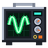 | **[`dtScope/`](./dtScope/)** | **Hybrid Vintage Tektronix CRT + Digital Storage Oscilloscope, FFT & Tone Generator** | `Radio Apps Subpanel` |
|  | **[`dtDecoder/`](./dtDecoder/)** | **Live CW/Morse, RTTY, SAME/EAS, SSTV & HF Weather-Fax (`WEFAX`) Audio Decoder** | `Radio Apps Subpanel` |
| 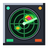 | **[`dtRadar/`](./dtRadar/)** | **NWS NEXRAD Doppler, GOES-18/16 Satellite & NOAA Solar/HF Propagation Console** | `Radio Apps Subpanel` |
|  | **[`dtSat/`](./dtSat/)** | **NORAD / ISS / Amateur Radio Satellite Pass, Sky-Dome & Live Doppler Tracker** | `Radio Apps Subpanel` |
|  | **[`dtLog/`](./dtLog/)** | **Ham QSO & SWL Station Logbook (`ADIF`) with Great-Circle Rotor Beam Compass** | `Radio Apps Subpanel` |
| 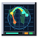 | **[`dtMaps/`](./dtMaps/)** | **GridTracker-Style PSKReporter & Live Multi-Mode FT8 Propagation Atlas** | `Utilities Subpanel` |
| 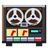 | **[`dtDeck/`](./dtDeck/)** | **Vintage 4-Track Simul-Sync Reel/Cassette Studio with Ballistic VU Meters & 10-Band EQ** | `Utilities Subpanel` |
|  | **[`dtSys/`](./dtSys/)** | **Vintage Analog Needle Gauge & SGI/Sun Strip-Chart Hardware Telemetry Console** | `Utilities Subpanel` |
|  | **[`dtNet/`](./dtNet/)** | **SunNet/SGI-Style Analog Network Throughput Gauges & Visual World Traceroute Radar** | `Utilities Subpanel` |
| 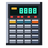 | **[`dtCalc/`](./dtCalc/)** | **Native OSF/Motif RPN, Algebraic, Scientific, RF & 64-Bit LED Programmer Calculator** | `Utilities Subpanel` |
|  | **[`dtDeluge/`](./dtDeluge/)** | **Transmission-Style BitTorrent & Magnet Client in CDE OSF/Motif Livery** | `Utilities Subpanel` |

---

## CDE Palette & Front Panel Architecture

1. **Dynamic OSF/Motif Palette Synchronization:** At launch, every app queries `xrdb` / Xrm for the active CDE `ColorPalette` (such as `Crimson.dp`, `Broica.dp`, `Alpine.dp`, or `Default.dp`) from `~/.dt/palettes` or `/usr/dt/palettes`, binding its 3D beveled chrome (`#AEB2C3`), selection highlight, warm cream sunken reading wells (`#FFF7E9`), and subtle vintage **greenbar** alternating list rows (`#EEF4DB`) automatically.
2. **Authentic Multi-Size XPM Icons:** Each folder ships `48×48` (`.l.pm` / `.pm`), `32×32` (`.m.pm`), `24×24` (`.s.pm`), and `16×16` (`.t.pm`) transparent X11 Pixmap icons for crisp rendering across the Front Panel, subpanels, `dtfile`, and minimized `dtwm` desktop icons.
3. **Scoped `DtDts` File Associations:** File double-click actions (`dtPics` for images, `dtPlay` for audio/video, `dtReader` for PDFs, `dtNotes` for RTF/Markdown/text, `dtZip` for archives, `dtDeluge` for `.torrent` & `magnet:`, `dtCalendar` for `.ics` invites) register cleanly inside `~/.dt/types/`.
4. **Multi-Column Subpanels & Centered Front Panel ([`dtSubpanel/`](./dtSubpanel/)):** Ships a lightweight `LD_PRELOAD` `dtwm` companion (`libdtwm_subpanel_cols.so` + `dtwm-wrapper`) that automatically splits tall subpanels (such as **Utilities**) into balanced two-column grids that never overlap the main Front Panel, while keeping the Front Panel locked bottom-center across **Restart Workspace Manager**.

---

## Quick Start & Installation

### System Dependencies (Debian / Ubuntu)

```bash
sudo apt update
sudo apt install -y \
  build-essential libmotif-dev libx11-dev libxt-dev libxpm-dev \
  python3 python3-gi python3-gi-cairo gir1.2-gtk-3.0 gir1.2-gdkpixbuf-2.0 \
  gir1.2-gstreamer-1.0 gir1.2-gst-plugins-base-1.0 gstreamer1.0-plugins-good \
  gstreamer1.0-plugins-bad gstreamer1.0-plugins-ugly gstreamer1.0-libav \
  gir1.2-webkit2-4.1 gir1.2-gtksource-4 gir1.2-evince-3.0 \
  python3-pil python3-numpy python3-requests imagemagick p7zip-full
```

*(Note: `dtMail`, `dtCalendar`, `dtTerm`, and `dtCalc` also link against `/usr/dt/include` and `/usr/dt/lib` from a standard CDE installation.)*

### Install All 25 Applications

```bash
git clone https://github.com/andarazoroflove/dt.git
cd dt
./install-all.sh
```

Or install any individual application from its own directory:

```bash
cd dtPod && ./install.sh
```

After installing, reload the CDE Workspace Manager (**Workspace Menu -> Restart Workspace Manager**) so the Front Panel **Utilities**, **Mail**, and **Radio Apps** subpanels pick up all new icons.

---

##  dtMail

**Folder:** [`./dtMail/`](./dtMail/) &nbsp;•&nbsp; **Front Panel:** `Mail Subpanel` &nbsp;•&nbsp; **Stack:** C11 • OSF/Motif (`libXm` / `libDtWidget`) • Python 3 Graph Sync • WebKit2GTK Reading Pane

A classic three-pane workstation mail client written in C and OSF/Motif 2.3 that binds dynamically to your active CDE color palette. Features zero-config Microsoft 365 browser sign-in (OAuth 2.0 + 2FA), an SQLite3 local message cache, vintage greenbar alternating message rows, an embedded HTML reading pane via X11 window reparenting, attachment chips, and 1-click RSVP integration with `dtCalendar`.

<p align="center">
  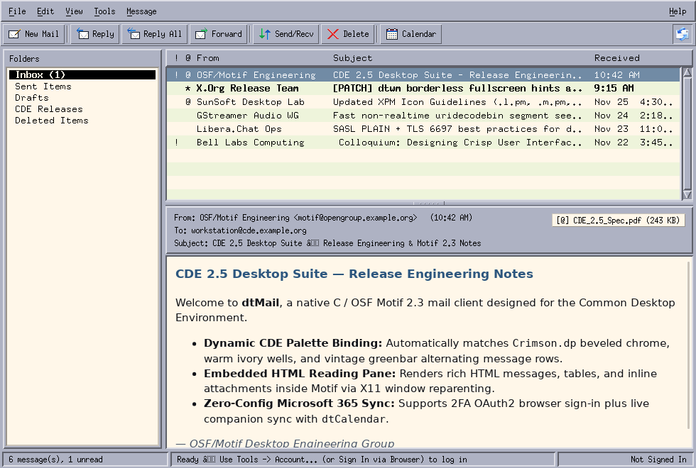
</p>

### Highlights
- **Dynamic CDE Palette Binding** — Reads `*ColorPalette` (`Crimson.dp`, `Broica.dp`, etc.) for 3D beveled Motif chrome, warm ivory wells (`#FFF7E9`), and subtle greenbar row shading (`#EEF4DB`), plus an optional Dark Motif toggle.
- **Zero-Config Microsoft 365 OAuth 2.0 + 2FA** — Sign in via WebKit2GTK (`cde-mail-webauth`) and sync folders, subfolders, and messages over Microsoft Graph v1.0.
- **Embedded HTML Reading Pane** — Safely renders HTML emails (JavaScript disabled) inside the bottom-right Motif `XmDrawingArea` with synchronized `Ctrl++` / `Ctrl+-` font scaling.
- **Meeting Invitation Banner** — Detects `.ics` and Exchange calendar invites with inline **Accept / Tentative / Decline** actions synchronized directly with `dtCalendar`.

```bash
cd dtMail && make && ./install.sh
```
---

##  dtCalendar (`dtcm`)

**Folder:** [`./dtCalendar/`](./dtCalendar/) &nbsp;•&nbsp; **Front Panel:** `Front Panel Date / Calendar (`Dtcm`)` &nbsp;•&nbsp; **Stack:** C11 • OSF/Motif (`libXm` / `libDtWidget`) • Python 3 Graph Calendar Engine

A drop-in native OSF/Motif replacement for stock CDE `dtcm` that shares OAuth 2.0 credentials seamlessly with `dtMail`. Displays interactive Month, Week, and Day schedules, supports creating and editing events with attendees, handles incoming `.ics` meeting invitations, and syncs bi-directionally with Microsoft 365.

<p align="center">
  
</p>

### Highlights
- **Front Panel `Dtcm` Integration** — Launches directly when clicking the CDE Front Panel date/calendar icon.
- **Shared Microsoft 365 Sync** — Reuses `dtMail`'s OAuth2 token store (`~/.config/cde-mail/`) with file-locked automatic refresh.
- **Full Appointment & Attendee Editor** — Create, update, delete, and RSVP (`Accept`, `Tentative`, `Decline`) to meetings.
- **`.ics` File Import** — Double-click any `.ics` invitation in `dtfile` to import or inspect it directly.

```bash
cd dtCalendar && make && ./install.sh
```
---

##  dtTerm

**Folder:** [`./dtTerm/`](./dtTerm/) &nbsp;•&nbsp; **Front Panel:** `Utilities Subpanel` &nbsp;•&nbsp; **Stack:** C11 • OSF/Motif (`libXm`) • CDE `libDtTerm` (`DtCreateTerm`)

A multi-tab upgrade to CDE's classic `dtterm` that embeds genuine `DtCreateTerm` terminal widgets inside a 3D beveled Motif tab deck. Preserves authentic CDE terminal emulation, scrollbars, fonts, and palette resources while adding 1-click tab management and built-in smart clipboard shortcuts.

<p align="center">
  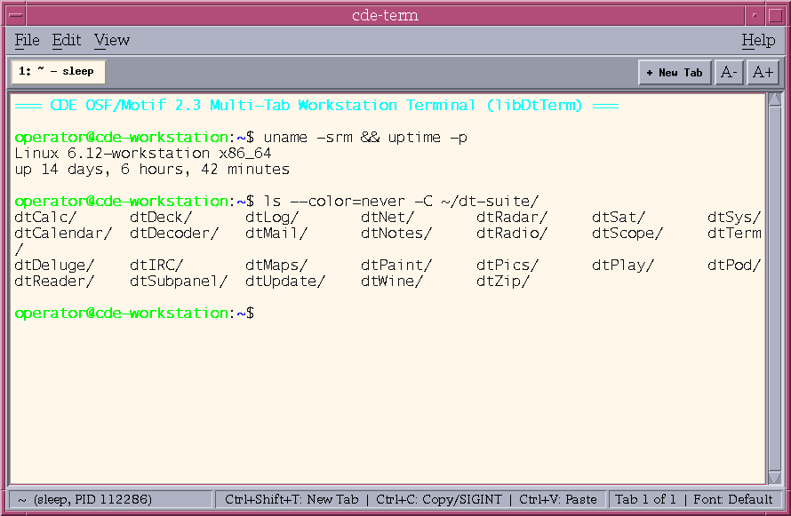
</p>

### Highlights
- **Multi-Tab Motif Deck (`+ New Tab` / `Ctrl+Shift+T`)** — Open additional tabs that automatically inherit the active tab's working directory (`/proc/<pid>/cwd`), switch with `Ctrl+Tab` / `Alt+1`–`Alt+9`, and right-click tabs to **Duplicate**, **Rename**, or **Close Other Tabs**.
- **Built-in Smart Clipboard** — `Ctrl+C` copies selected text to `CLIPBOARD` and clears the highlight (or sends normal `^C` `SIGINT` when nothing is selected); `Ctrl+V` pastes from `CLIPBOARD`.
- **Dynamic CDE Palette & Retro Themes** — Syncs with your active CDE palette (`Crimson.dp`, `Broica.dp`, etc.) and switches instantly between **CDE Palette**, **Dark Workstation**, **Green Phosphor**, and **Amber Phosphor**, plus `[A-]`/`[A+]` (`Ctrl+-`/`Ctrl++`) font zoom.

```bash
cd dtTerm && ./install.sh
```
---

##  dtPod

**Folder:** [`./dtPod/`](./dtPod/) &nbsp;•&nbsp; **Front Panel:** `Utilities Subpanel` &nbsp;•&nbsp; **Stack:** Python 3 • GTK 3 (CDE Motif CSS) • GStreamer 1.0 • Cairo • Public iTunes API

A full-featured Apple Podcasts browser, subscription manager, and audio player requiring zero login or API keys. Search by show title, artist/creator, or browse the Apple Top 25 chart, subscribe to favorite shows, inspect high-resolution show and episode artwork, read formatted show notes, stream instantly, or right-click any episode to download it for offline listening.

<p align="center">
  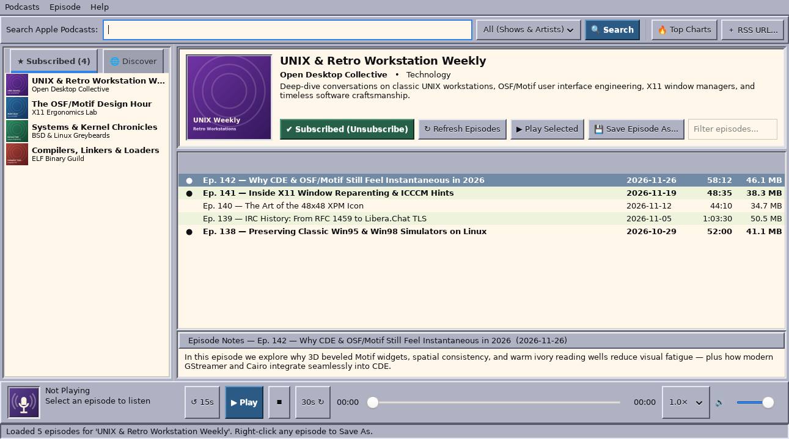
</p>

### Highlights
- **Public Apple Podcasts API + RSS Engine** — Search shows, hosts, and artists or load Top Charts with zero account login.
- **Subscriptions & OPML Support** — Subscribe/unsubscribe in one click (`~/.config/dtpod/subscriptions.json`), plus OPML import and export.
- **High-Res Cover Artwork Cache** — Asynchronous disk/memory artwork cache rendering thumbnails in show lists and a `136×136` sunken Motif header frame.
- **Right-Click `Save Episode As...`** — Download episodes in the background with live progress, or stream directly with `-15s`/`+30s` skip and `0.75×`–`2.0×` playback speed.

```bash
cd dtPod && ./install.sh
```
---

##  dtPaint

**Folder:** [`./dtPaint/`](./dtPaint/) &nbsp;•&nbsp; **Front Panel:** `Utilities Subpanel` &nbsp;•&nbsp; **Stack:** Python 3 • GTK 3 (CDE Motif CSS) • Cairo • Pillow • GdkPixbuf • ImageMagick

A faithful CDE clone of classic MS Paint upgraded to open and save every modern and vintage image format supported by `dtPics`. Combines the iconic MS Paint Ribbon workflow — selection modes, brushes, 20 geometric shapes, flood fill, Color 1 / Color 2 mouse buttons, and draggable canvas resize handles — with authentic CDE beveled chrome and custom vector tool icons.

<p align="center">
  
</p>

### Highlights
- **Universal Image I/O** — Opens and exports `.png`, `.jpg`, `.bmp`, `.gif`, `.heic`, `.avif`, `.jxl`, `.webp`, `.tiff`, `.svg`, `.ico`, `.icns`, `.ppm`, `.xpm`, `.tga`, and `.psd`.
- **Full MS Paint Toolkit** — Rectangular & Free-Form Lasso selection (with **Transparent Selection** background keying), Cut/Copy/Paste floating selections, Pencil, Flood Fill, Text Box, Eraser (Color 2), Eyedropper, and Magnifier.
- **6 Brushes & 20 Geometry Shapes** — Round, Square, Calligraphy `/` & `\`, Airbrush Spray, and Marker brushes; Line, 2-step bendable Bezier Curve, Oval, Rounded Rect, Polygons, 4-way Arrows, 4/5/6-Point Stars, Speech Callout, Heart, and Lightning Bolt.
- **Seamless Workflow** — Integrated directly with `dtPics` and CDE Screenshot via **Open with dtPaint**, plus 30-step Undo/Redo.

```bash
cd dtPaint && ./install.sh
```
---

##  dtPlay

**Folder:** [`./dtPlay/`](./dtPlay/) &nbsp;•&nbsp; **Front Panel:** `Utilities Subpanel` &nbsp;•&nbsp; **Stack:** Python 3 • GTK 3 (CDE Motif CSS) • GStreamer 1.0 (`playbin` + `gtksink` + `x264enc`)

A streamlined CDE music and movie player supporting `.wav`, `.mp3`, `.m4a`, `.m4v`, `.flac`, `.mp4`, `.mov`, `.avi`, `.mpeg`, `.mkv`, `.webm`, `.ogg`, and `.opus`. Opens to `~/Music` in `dtMail`'s signature greenbar directory browser (with `..` parent folder navigation), switches to a native video or retro 20-band spectrum stage on double-click, goes borderless fullscreen, and includes a 1-click **Make a Clip** snippet studio.

<p align="center">
  
</p>

### Highlights
- **Greenbar `~/Music` Browser** — Browse `~/Music` or navigate anywhere via `..` and quick folder shortcuts; double-click to play and click **`◀ Back to List`** anytime.
- **Borderless Full Screen (`F11` / `F`)** — Uses `_MOTIF_WM_HINTS` decoration removal + fullscreen state for edge-to-edge cinema playback in `dtwm` with auto-revealing bottom controls.
- **`✂ Make a Clip` (60s Snippet Studio)** — Captures up to 60 seconds of audio or video starting from the moment you press the button and opens it in a second **dtPlay Clip Studio** window to trim `Start`/`End` further or **Save Clip As**.
- **Default CDE Media Handler** — Registers `DtDts` and XDG MIME associations for double-clicked audio and video files.

```bash
cd dtPlay && ./install.sh
```
---

##  dtIRC

**Folder:** [`./dtIRC/`](./dtIRC/) &nbsp;•&nbsp; **Front Panel:** `Utilities Subpanel` &nbsp;•&nbsp; **Stack:** Python 3 • GTK 3 (CDE Motif CSS) • Python `ssl` Socket Engine • RFC 1459 / IRCv3 SASL

A full-featured CDE IRC client pre-wired to connect to `irc.libera.chat:6697` over TLS. Features saved NickServ credentials (`0600` permissions) with SASL PLAIN and customizable `IDENTIFY` commands, a left-hand ranked channel user list with right-click Operator actions, a directly editable top channel topic bar, cream-adapted mIRC colors, and instant font zoom buttons.

<p align="center">
  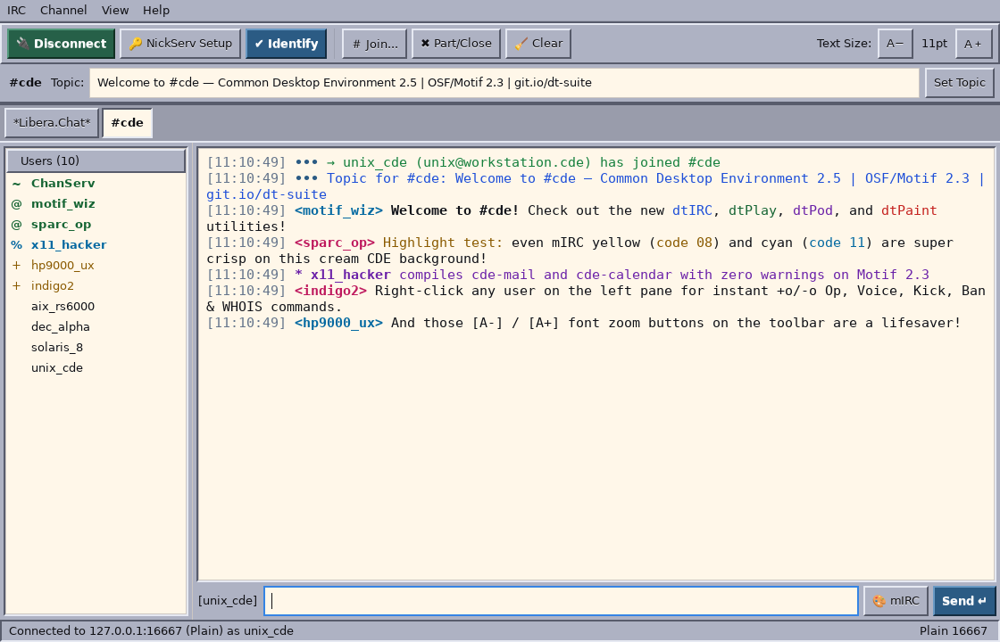
</p>

### Highlights
- **Libera.Chat TLS & Saved NickServ Auth** — Supports both IRCv3 `SASL PLAIN` during connection and saved `/msg NickServ IDENTIFY` templates + a 1-click **`✔ Identify`** toolbar button.
- **Left-Hand Ranked User List & Right-Click Op Menu** — Sorts `~`, `&`, `@`, `%`, `+` ranks on the left; right-click any nick for **Op/Deop**, **Voice/Devoice**, **Half-Op**, **Kick**, **Ban (`*!*@host`)**, **Kick + Ban**, **Quiet/Unquiet (`+q`/`-q`)**, **WHOIS**, **PM**, and **CTCP**.
- **Top Editable Channel Topic Bar** — View and update the active channel's `TOPIC` directly from the top entry bar.
- **Cream-Refactored mIRC Colors & `[A−]`/`[A＋]` Zoom** — Full mIRC `00`–`99` color/bold/italic/underline parser tuned for high contrast on CDE's `#FFF7E9` cream background, plus 1-click text scaling (`8pt`–`26pt`) and complete `/command` support.

```bash
cd dtIRC && ./install.sh
```
---

##  dtPics

**Folder:** [`./dtPics/`](./dtPics/) &nbsp;•&nbsp; **Front Panel:** `Utilities Subpanel` &nbsp;•&nbsp; **Stack:** Python 3 • GTK 3 (CDE Motif CSS) • Cairo • Pillow • GdkPixbuf • ImageMagick

A fast CDE image viewer and quick photo editor supporting modern mobile and web formats (HEIC/HEIF, AVIF, JPEG-XL, WebP, animated GIF, SVG, PSD, TIFF, PNG, JPEG, XPM). Includes rule-of-thirds cropping, rotation/skew straightening, 1-click Magic Color auto-enhancement, callout arrows/boxes/text stamps, and 1-click handoff to `dtPaint`.

<p align="center">
  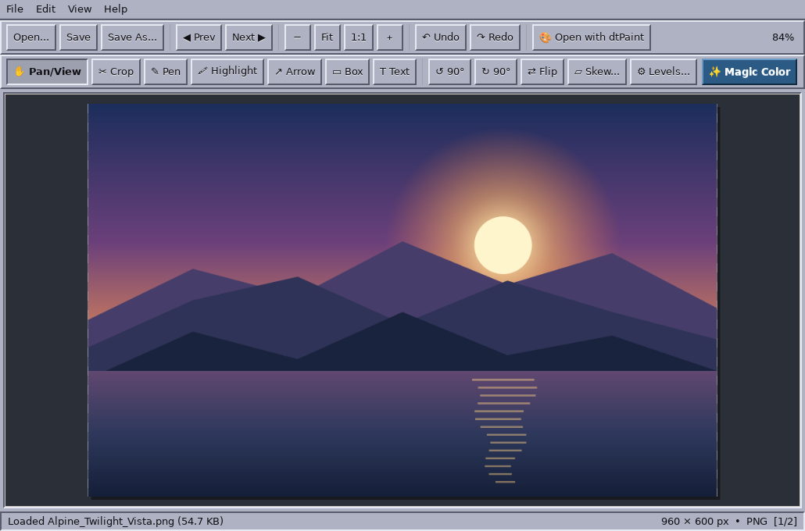
</p>

### Highlights
- **Broad Format Decoding** — Natively views static and animated `.gif`/`.webp`, iPhone `.heic`, `.avif`, `.jxl`, `.svg`, `.psd`, `.ico`, `.xpm`, and standard raster formats.
- **1-Click Magic Color & Manual Levels** — Outlier-safe percentile white balance, adaptive gamma shadow lift, vibrancy, and unsharp clarity.
- **Quick Callouts & Geometry** — Interactive Crop with rule-of-thirds guides, Skew/Straighten preview dialog, Pen, Highlighter, Arrow, Box, and outlined Text overlays.
- **Direct `Open with dtPaint` Button** — Jump straight from viewing/cropping into full pixel editing in `dtPaint`.

```bash
cd dtPics && ./install.sh
```
---

##  dtNotes

**Folder:** [`./dtNotes/`](./dtNotes/) &nbsp;•&nbsp; **Front Panel:** `Utilities Subpanel` &nbsp;•&nbsp; **Stack:** Python 3 • GTK 3 • GtkSourceView 4 • WebKit2GTK Live Markdown Preview

A modern replacement for stock `dtpad` styled for CDE. Supports multi-tab editing, native Rich Text Format (`.rtf`) reading and writing with bold/italic/underline/font colors, side-by-side Markdown (`.md`) live preview, and syntax-highlighted plain text and source files.

<p align="center">
  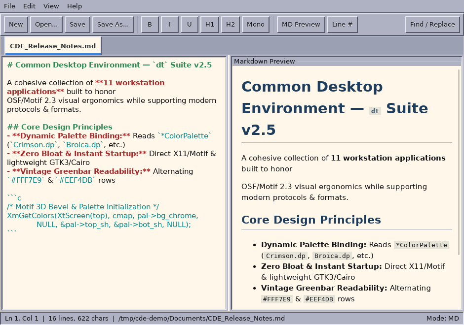
</p>

### Highlights
- **Native `.rtf` Serializer & Parser** — Edit formatted Rich Text documents without heavyweight office suites.
- **Live Markdown Split Preview** — Toggle a live CDE-themed WebKit2 preview pane while writing `.md` documentation.
- **GtkSourceView 4 Engine** — Line numbers, undo/redo, find & replace, and syntax highlighting in warm CDE cream wells.

```bash
cd dtNotes && ./install.sh
```
---

##  dtReader

**Folder:** [`./dtReader/`](./dtReader/) &nbsp;•&nbsp; **Front Panel:** `Utilities Subpanel` &nbsp;•&nbsp; **Stack:** Python 3 • GTK 3 • EvinceDocument 3.0 & EvinceView 3.0 (Poppler)

A crisp, fast PDF viewer and fillable form editor for CDE powered by Poppler/Evince. Supports page thumbnails and document outlines, full-text search, rotation, printing, and direct on-page editing and atomic saving of interactive PDF AcroForm fields.

<p align="center">
  
</p>

### Highlights
- **Interactive Fillable PDF Forms** — Click directly into PDF text fields, checkboxes, radio buttons, and dropdowns and save cleanly (`Ctrl+S` / `Ctrl+Shift+S`).
- **Sidebar Thumbnails & Outline Index** — Navigate long technical manuals and specifications effortlessly.
- **Native Print & Search** — Integrated GTK/CUPS printing and instant highlight search.

```bash
cd dtReader && ./install.sh
```
---

##  dtZip

**Folder:** [`./dtZip/`](./dtZip/) &nbsp;•&nbsp; **Front Panel:** `Utilities Subpanel` &nbsp;•&nbsp; **Stack:** Python 3 • GTK 3 (CDE Motif CSS) • `zipfile` / `tarfile` / `7z`

A classic UNIX/CDE archive utility supporting drag-and-drop extraction and creation of `.zip`, `.tar.gz`/`.tgz`, `.tar.bz2`, `.tar.xz`, `.tar.zst`, `.tar`, `.7z`, `.rar`, `.iso`, `.gz`, `.bz2`, and `.xz` archives, including `Extract Here` integration in `dtfile`.

<p align="center">
  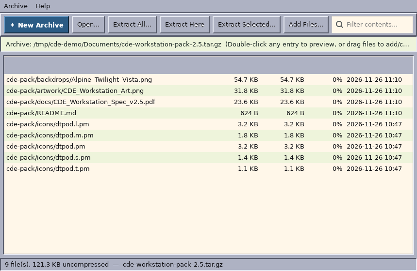
</p>

### Highlights
- **Universal Archive Inspection & Extraction** — Browse contents, sizes, ratios, and timestamps before extracting.
- **Drag-and-Drop Archive Creation** — Drop files or folders onto `dtZip` to package `.zip`, `.tar.gz`, `.tar.xz`, or `.7z` archives.
- **CDE File Manager Integration** — Adds `Open` and `Extract Here (dtZip)` actions to archive data types.

```bash
cd dtZip && ./install.sh
```
---

##  dtWine

**Folder:** [`./dtWine/`](./dtWine/) &nbsp;•&nbsp; **Front Panel:** `Utilities Subpanel` &nbsp;•&nbsp; **Stack:** Python 3 • GTK 3 (CDE Motif CSS) • Wine • Pure-Python PE/NE/ICO Icon Extractor

Manages classic Windows 95/98/XP/7/10 applications and offline GOG installers on CDE. Automatically configures compatible OpenGL WineD3D prefixes, extracts 32-bit PE and vintage 16-bit NE executable icons into multi-size CDE `.pm` XPM icons, and registers launchers directly into CDE's **Games** or **Personal Applications** Front Panel subpanels.

<p align="center">
  
</p>

### Highlights
- **GOG & Classic Installer Wizard** — Installs `.exe`, `.msi`, `.bat`, or portable folders into clean Wine prefixes while filtering out `Uninstall`/`Setup`/`Readme` clutter.
- **Pure-Python PE32 / PE32+ / 16-Bit NE Icon Extractor** — Converts embedded Windows DIB icons + 1-bit AND masks into native CDE `.l.pm`/`.m.pm`/`.s.pm`/`.t.pm` icons.
- **Per-App Windows Version & Virtual Desktop** — Switch `win95`..`win10`, `640x480`..`1280x720` virtual desktops, Winetricks runtimes, `winecfg`, and `regedit` in one click.

```bash
cd dtWine && ./install.sh
```
---

##  dtUpdate

**Folder:** [`./dtUpdate/`](./dtUpdate/) &nbsp;•&nbsp; **Front Panel:** `Utilities Subpanel` &nbsp;•&nbsp; **Stack:** Python 3 • GTK 3 (CDE Motif CSS) • APT (`Status-Fd`) • ELF `ldd` / `dpkg -S` Dependency Analyzer

An all-in-one workstation update manager for Debian (`apt-get`) and custom CDE applications. Prompts securely for `sudo`, runs `apt-get update`, inspects every installed CDE C/Motif binary and Python utility to build a targeted rebuild plan **only when needed**, asks for explicit **Yes / No** confirmation, downloads and installs updates with a live progress bar, recompiles affected CDE binaries atomically, restarts `dtwm`, and shows a full post-update overview.

<p align="center">
  
</p>

### Highlights
- **In-Memory `sudo` Auth & `apt-get update`** — Prompts for your `sudo` password (kept strictly in session memory) and runs `apt-get update` + `apt-get -s dist-upgrade`.
- **Smart CDE Rebuild Planner (Only When Needed)** — Maps `ldd -r` shared library dependencies via `dpkg -S` and checks local source `mtime`s so unaffected CDE apps are never needlessly rebuilt.
- **Explicit `[✔ Yes]` / `[✖ No]` Plan Approval** — Presents itemized greenbar tables of pending Debian package upgrades and planned CDE binary rebuilds before modifying the system.
- **Live Progress Bar, Atomic Rebuilds & `dtwm` Restart** — Streams APT download/install percentages via `APT::Status-Fd`, atomically installs rebuilt Motif binaries, restarts the CDE Workspace Manager (`dtwm`), and displays a **Finished Overview** changelog.

```bash
cd dtUpdate && ./install.sh
```
---

##  dtRadio

**Folder:** [`./dtRadio/`](./dtRadio/) &nbsp;•&nbsp; **Front Panel:** `Radio Apps Subpanel` &nbsp;•&nbsp; **Stack:** Python 3 • GTK 3 (CDE Motif CSS) • Cairo • GStreamer 1.0 DSP • KiwiSDR WebSocket Engine • RTL-SDR (`rtl_fm`)

A tabletop 1980s/1990s HF communications receiver styled for CDE. Combines live `0–30 MHz` off-air HF/Shortwave reception via the public KiwiSDR network with curated shortwave relays, linked amateur repeaters, NOAA Weather Radio, emergency feeds, space/mission audio, and plug-and-play USB RTL-SDR dongle support.

<p align="center">
  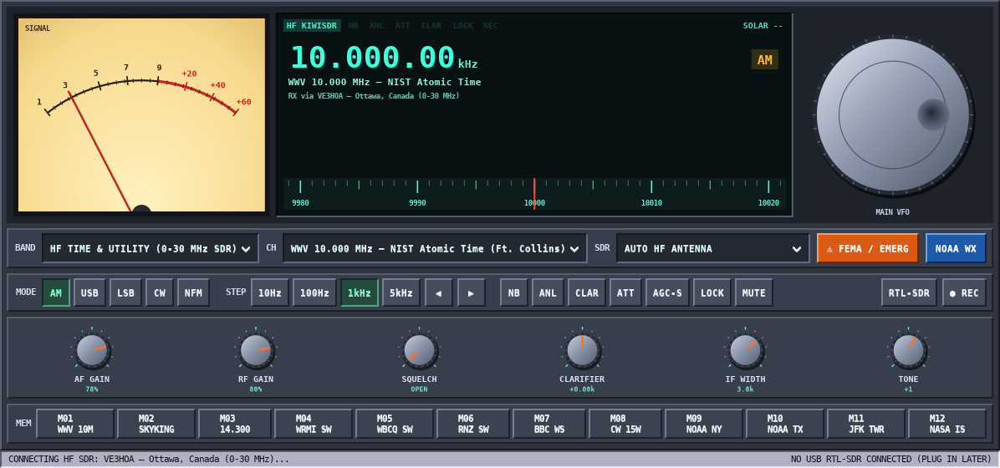
</p>

### Highlights
- **Vintage Receiver Faceplate** — Warm backlit ballistic analog **S-Meter**, glowing cyan-green **Vacuum Fluorescent Display (VFD)** + vernier slide-rule scale, and weighted spun-aluminum **VFO flywheel**.
- **Real-Time GStreamer Audio DSP Knobs** — Interactive rotary knobs and switches for **AF Gain**, **RF Gain**, **Squelch**, **Clarifier (`±2.50 kHz` RIT/Pitch)**, **IF Bandpass (`300 Hz` CW – `12 kHz` Wide)**, **Tone**, **Noise Blanker (`NB` + `NB Level`)**, and **ANL**.
- **Direct Emergency & NOAA Buttons + Hold-to-Save Memories** — Dedicated safety-orange **`FEMA / EMERG`** and NOAA-blue **`NOAA WX`** buttons, curated non-music category dropdowns, 12 press-and-hold memory presets (`M01`–`M12`), 1-click `.wav` aircheck recording, and plug-and-play **RTL-SDR** support.

```bash
cd dtRadio && ./install.sh
```
---

##  dtScope

**Folder:** [`./dtScope/`](./dtScope/) &nbsp;•&nbsp; **Front Panel:** `Radio Apps Subpanel` &nbsp;•&nbsp; **Stack:** Python 3 • GTK 3 (CDE Motif CSS) • Cairo • NumPy FFT • GStreamer 1.0

A hybrid Tektronix 465B analog phosphor CRT + HP 54600 Digital Storage Oscilloscope (DSO) and bench signal generator. Taps directly into your desktop PipeWire/PulseAudio `.monitor` bus (visualizing `dtRadio` live) or microphone, pairing classic illuminated graticules with precision digital cursors and built-in RF/AF test synthesis.

<p align="center">
  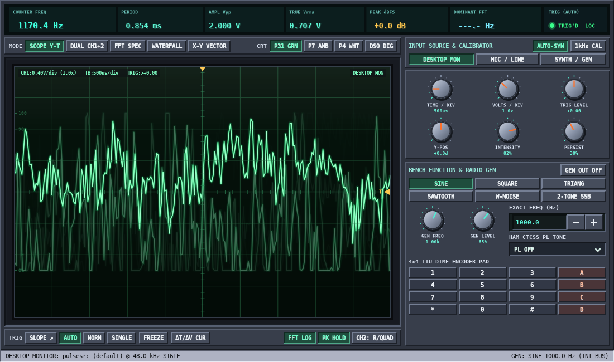
</p>

### Highlights
- **Switchable Analog Phosphor & DSO CRT Modes** — Toggle between **`P31 Green`**, **`P7 Long-Persistence Amber`**, **`P4 Monochrome White`**, and **`DSO Digital`** with live `Vpp`, `Vrms`, `Freq Hz`, `Duty %`, and `THD` VFD readouts plus draggable `ΔT` / `ΔV` measurement cursors.
- **4-Mode Bench Display** — Real-time **Triggered Timebase (`Y-T`)**, **`4096-pt` Blackman-Harris FFT Spectrum (`dBFS` + Peak Hold)**, **Scrolling Audio Waterfall**, and **X-Y Lissajous Phase Scope**.
- **Integrated Signal, CTCSS & DTMF Generator** — Synthesize Sine, Square, Triangle, Sawtooth, White/Pink Noise, **2-Tone SSB IMD test pairs**, **38 EIA CTCSS PL sub-audible tones**, and **16-key DTMF bursts** straight to your audio output or loopback.

```bash
cd dtScope && ./install.sh
```
---

##  dtDecoder

**Folder:** [`./dtDecoder/`](./dtDecoder/) &nbsp;•&nbsp; **Front Panel:** `Radio Apps Subpanel` &nbsp;•&nbsp; **Stack:** Python 3 • GTK 3 (CDE Motif CSS) • Cairo • NumPy DSP • GStreamer 1.0

A vintage multi-mode HF digital & facsimile audio decoder pairing a glowing waterfall and HAL-style **crossed-ellipse X-Y RTTY tuning scope** with live demodulators for **CW/Morse**, **RTTY (Baudot)**, **NOAA/FEMA SAME-EAS headers**, **HF Weather-Fax (`WEFAX` IOC 576)** thermal drum charts, and **Slow-Scan TV (`SSTV`)** images.

<p align="center">
  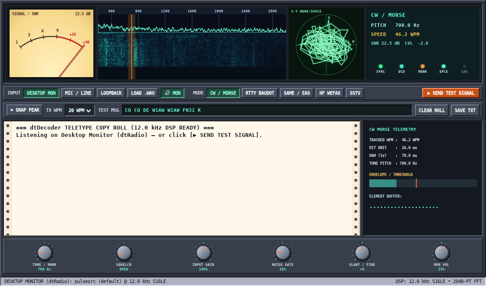
</p>

### Highlights
- **5 Off-Air Demodulators in One Console** — Adaptive-WPM **CW/Morse** pitch tracker, `45.45`/`50`/`75`-baud **ITA2 RTTY** (`170`/`425`/`850 Hz` shift + USOS), `520.83`-baud AFSK **NOAA/FEMA `ZCZC` SAME-EAS** alert decoder, **Alden Thermal-Drum `WEFAX`** (`120`/`240 LPM`, `IOC 576`), and **`SSTV`** (`Martin M1`, `Scottie S1`, `Robot 36`).
- **HAL ST-6000 Crossed-Ellipse Scope & Tuning Waterfall** — Classic dual-axis Mark/Space orthogonal tuning indicator alongside a clickable audio passband waterfall.
- **Built-In Closed-Loop Test Transmitters** — Every mode includes a `[▶ SEND TEST SIGNAL]` synthesizer (CW callsign messages, RTTY weather bulletins, SAME-EAS bursts, USCG surface pressure charts, and color SMPTE SSTV test cards) for zero-antenna bench testing.

```bash
cd dtDecoder && ./install.sh
```
---

##  dtRadar

**Folder:** [`./dtRadar/`](./dtRadar/) &nbsp;•&nbsp; **Front Panel:** `Radio Apps Subpanel` &nbsp;•&nbsp; **Stack:** Python 3 • GTK 3 (CDE Motif CSS) • Cairo • NOAA / NWS / SWPC Public Feeds

A 1990s NWS & space-weather workstation desk displaying animated **NEXRAD Doppler radar reflectivity loops**, **GOES-16/18 GeoColor & Clean IR satellite** sectors, live **NOAA SWPC X-Ray Flare / `Kp` / `SFI` HF Band-Condition matrices**, aviation **METAR/TAF** teletype reports, and backlit analog weather instruments.

<p align="center">
  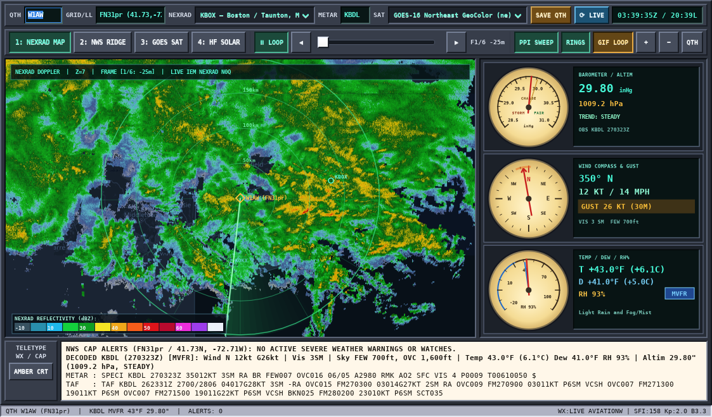
</p>

### Highlights
- **4 Tactical CRT Modes + Animated Loop Scrubber** — Switch instantly between **NEXRAD Doppler Slippy Map** (6-frame `30-min` `N0Q` reflectivity + rotating PPI sweep arm + NWS CAP warning polygons), **NWS Station RIDGE Radar**, **GOES-16/18 Satellite & Aurora Oval**, and the **HF Solar & Propagation Desk**.
- **Live Space Weather & HF Band Matrix** — Plots 6-hour GOES X-Ray flux (`A/B/C/M/X`), 3-hour Planetary `Kp` bars, `10.7cm SFI`, and calculated **`80m–6m` Day/Night Band Conditions (`GOOD / FAIR / POOR`)**.
- **Backlit Analog Weather Rack & Teletype** — Edge-lit **Barometer (`inHg`/`hPa`)**, **360° Wind Compass (`KT`/`MPH`)**, **Dual-Needle Thermometer/Dewpoint**, and sunken `#FFF7E9`/Amber **ICAO METAR & TAF** teletype strip.

```bash
cd dtRadar && ./install.sh
```
---

##  dtSat

**Folder:** [`./dtSat/`](./dtSat/) &nbsp;•&nbsp; **Front Panel:** `Radio Apps Subpanel` &nbsp;•&nbsp; **Stack:** Python 3 • GTK 3 (CDE Motif CSS) • Cairo • SGP4/J2 Orbital Propagator • CelesTrak TLE

A NORAD / NASA mission-control orbital pass and amateur radio Doppler tracker. Computes multi-orbit ground tracks, radio horizon footprints, circular **Az/El polar sky-dome trajectories**, 24-hour pass tables, and real-time **uplink/downlink Doppler frequency correction** for the ISS, NOAA weather birds, and FM/linear amateur satellites.

<p align="center">
  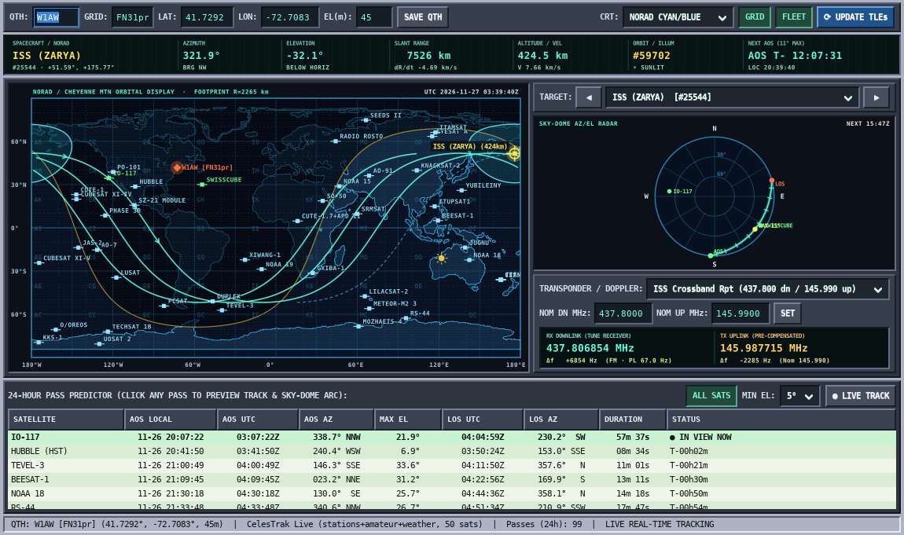
</p>

### Highlights
- **Offline + Live CelesTrak SGP4/J2 Engine** — Ships with 15 built-in spacecraft TLEs (`ISS`, `SO-50`, `AO-91`, `RS-44`, `AO-7`, `IO-117`, `PO-101`, `NOAA 15/18/19`, `METEOR-M2 3`, `CSS`, `HST`) so it works 100% offline out of the box, plus 1-click `[⟳ UPDATE TLEs]` from CelesTrak.
- **NORAD World Map & Polar Az/El Sky-Dome** — Displays 3-orbit ground tracks, solar day/night terminator, Maidenhead grid, spherical radio footprint, and live antenna sky-dome pass arcs in **`NORAD Cyan/Blue`**, **`P31 Phosphor Green`**, or **`Amber Tactical`** themes.
- **Full-Duplex Radio Doppler Computer** — Real-time range-rate VFD computing exact Doppler-corrected RX downlink and TX uplink frequencies across satellite transponder presets, plus a sortable 24-hour `AOS / MAX EL / LOS` pass predictor.

```bash
cd dtSat && ./install.sh
```
---

##  dtLog

**Folder:** [`./dtLog/`](./dtLog/) &nbsp;•&nbsp; **Front Panel:** `Radio Apps Subpanel` &nbsp;•&nbsp; **Stack:** Python 3 • GTK 3 (CDE Motif CSS) • Cairo • SQLite3 • ADIF 3.1.4

A shack QSO and SWL station logbook featuring 1-click **`Grab from dtRadio`** tuning import, an offline 265+ entity DXCC callsign prefix & zone resolver, a backlit **analog Great-Circle Azimuth Rotor Compass**, QSL card PNG/ASCII export, and full **ADIF (`.adi`)** import/export.

<p align="center">
  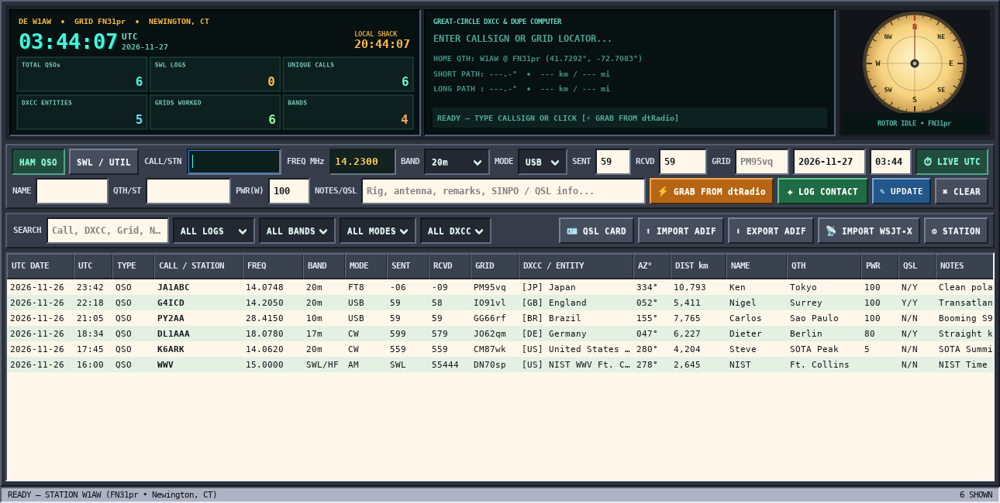
</p>

### Highlights
- **360° Analog Great-Circle Beam Compass & Offline DXCC Engine** — Type any amateur callsign or SWL station (`WWV`, `CHU`, `BBC`, etc.) to resolve DXCC country, CQ/ITU zones, instant dupe status, and live **Short-Path / Long-Path rotor bearings & distances (`km` / `mi`)**.
- **1-Click `[⚡ GRAB FROM dtRadio]` & WSJT-X Sync** — Pulls the live frequency, band, mode, and station title straight from `dtRadio` or imports `~/.local/share/WSJT-X/wsjtx_log.adi` with automatic duplicate skipping.
- **Greenbar SQLite Logbook & Vintage QSL Card Studio** — Tractor-feed `#FFF7E9`/`#EEF4DB` sortable log table with full **ADIF 3.1.4** round-trip export/import and custom Cairo **Postcard QSL `.PNG` & ASCII** generation.

```bash
cd dtLog && ./install.sh
```
---

##  dtMaps

**Folder:** [`./dtMaps/`](./dtMaps/) &nbsp;•&nbsp; **Front Panel:** `Utilities Subpanel` &nbsp;•&nbsp; **Stack:** Python 3 • GTK 3 (CDE Motif CSS) • Cairo • SQLite Tile Cache • PSKReporter HTTP & Live MQTT

A GridTracker-style zoomable propagation atlas (`GRIDTRACKER DARK`, `TOPOGRAPHIC`, `DAYLIGHT`, `AMBER PHOSPHOR`, `NIGHT-VISION RED`) combining dedicated 24-hour **PSKReporter** station lookups with a live `mqtt.pskreporter.info` multi-mode **FT8 / FT4 / JS8 / CW / WSPR** firehose, shaded Maidenhead grid squares, band-colored great-circle geodesic arcs, solar greyline terminator, and ADIF/WSJT-X UDP log integration.

<p align="center">
  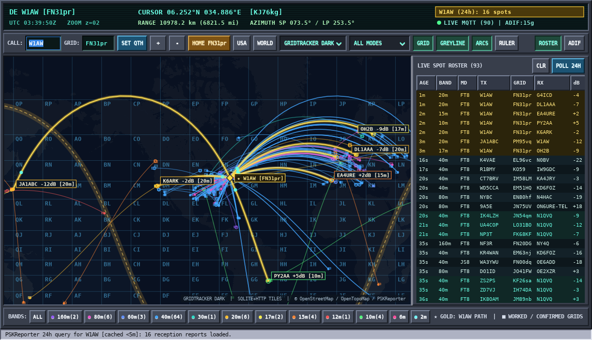
</p>

### Highlights
- **5-Mode Zoomable Slippy Atlas + Offline Vector World** — Smooth cursor-anchored wheel zoom (`z=2..15`), SQLite tile cache (`~/.cache/dtmaps/tiles.sqlite`), and embedded offline vector coastlines/borders across Dark, Topographic, Daylight, Amber Phosphor, and Night-Vision Red modes.
- **Dual PSKReporter Engine (24h HTTP + Live MQTT Firehose)** — Combines polite 5-minute cached `retrieve.pskreporter.info` 24-hour station queries (highlighted with pulsing gold geodesic arcs and SNR pills) with a pure-Python `mqtt.pskreporter.info:1883` live spot stream.
- **Maidenhead Grid Shading, Greyline & WSJT-X UDP** — Adaptive `2/4/6-char` Maidenhead grid overlay, Worked/Confirmed ADIF grid coloring, live `127.0.0.1:2237` WSJT-X UDP listener, solar greyline terminator, interactive **Range & Bearing Ruler**, and clickable `160m–2m` band filter pills.

```bash
cd dtMaps && ./install.sh
```
---

##  dtDeck

**Folder:** [`./dtDeck/`](./dtDeck/) &nbsp;•&nbsp; **Front Panel:** `Utilities Subpanel` &nbsp;•&nbsp; **Stack:** Python 3 • GTK 3 (CDE Motif CSS) • Cairo • NumPy • GStreamer 1.0

A vintage TASCAM/TEAC-inspired 4-track `Simul-Sync` reel-to-reel and cassette studio deck featuring area-accurate spinning reels, dual warm-backlit **ballistic analog VU meters**, 4-digit mechanical drum + VFD counter, 4-channel fader/pan overdub mixer, `dtRadio` aircheck browser, 10-band graphic EQ, varispeed (`±20%`), and stereo `.wav` master bounce.

<p align="center">
  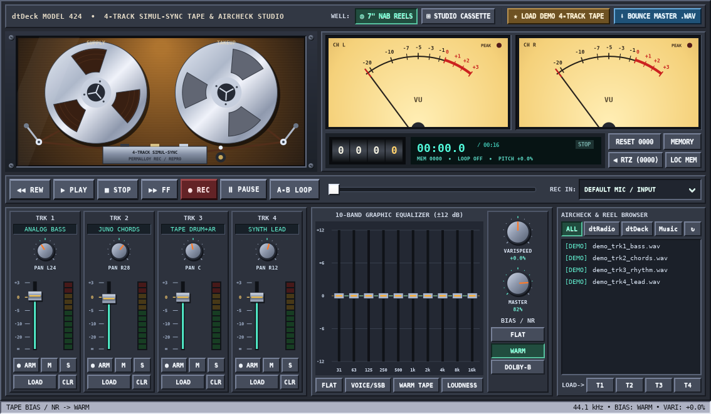
</p>

### Highlights
- **Switchable `10.5"` NAB Open-Reel & Compact Cassette Transport** — Area-conserving supply/takeup tape pack physics, capstan/pinch-roller animation, **`7.5` / `15 IPS`** speed modes, `RTZ` zero-return, `A–B` loop, and **`±20%` Pitch/Varispeed** flywheel.
- **Dual Warm-Backlit Ballistic VU Meters** — Classic `-20` to `+3 dB` red-zone analog needles with peak-clip jewel LEDs alongside a 4-digit mechanical odometer and VFD tape timer.
- **4-Track `Simul-Sync` Overdub Mixer & 10-Band EQ** — Per-track `REC ARM`, `MUTE`, `SOLO`, pan, fader, 10-band graphic equalizer (`31 Hz–16 kHz`), `dtRadio` recordings browser, built-in 4-track synth demo session, and 1-click stereo `.wav` bounce.

```bash
cd dtDeck && ./install.sh
```
---

##  dtSys

**Folder:** [`./dtSys/`](./dtSys/) &nbsp;•&nbsp; **Front Panel:** `Utilities Subpanel` &nbsp;•&nbsp; **Stack:** Python 3 • GTK 3 (CDE Motif CSS) • Cairo • Linux `/proc` & `/sys`

A control-room analog needle gauge panel and SGI `gr_osview` / Sun `perfmeter` strip-chart rack monitoring CPU, RAM/Swap, Core Thermals (`x86_pkg_temp`), System Battery & AC Mains (`BAT0`/`BAT1` voltage, draw, wear, AC jewel lamps), Network RX/TX, Disk I/O, and live greenbar processes—with a 1-click `[COMPACT RACK]` desktop widget mode.

<p align="center">
  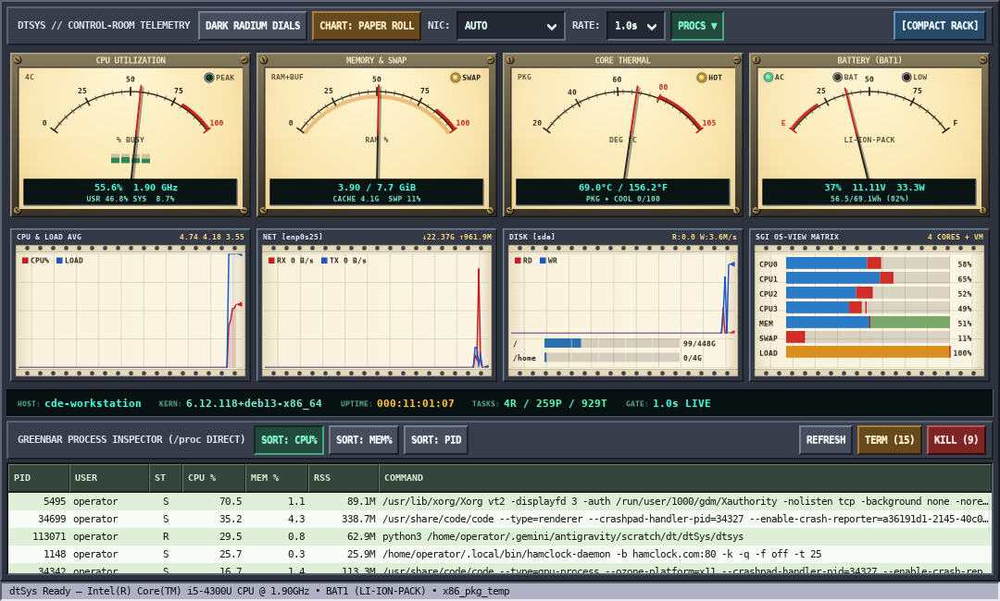
</p>

### Highlights
- **4 Edge-Lit Ballistic Analog Needle Dials** — Smooth spring-damped needles with peak-hold markers and jewel pilot lamps for **CPU %**, **Memory & Swap**, **Core Thermal (`°C`/`°F`)**, and **Battery / AC Power**, switchable between **Warm Incandescent Cream** and **Dark Radium Night** dials.
- **4 Rolling 120-Sample Drum / Strip-Chart Recorders** — Live **CPU & Load Avg**, **Network RX/TX**, **Disk I/O + `/` & `/home` Fuel Bars**, and an SGI-style **Per-Core Bar Matrix**, switchable between **Tractor-Feed Paper + Pen Ink** and **CRT Phosphor** traces.
- **Zero-Dependency `/proc` Process Inspector & `[COMPACT RACK]`** — Sortable `#FFF7E9` greenbar process table plus a `340×600` vertical desktop rack widget mode.

```bash
cd dtSys && ./install.sh
```
---

##  dtNet

**Folder:** [`./dtNet/`](./dtNet/) &nbsp;•&nbsp; **Front Panel:** `Utilities Subpanel` &nbsp;•&nbsp; **Stack:** Python 3 • GTK 3 (CDE Motif CSS) • Cairo • `/proc/net` • Visual World Traceroute

A SunNet / SGI NetVisualizer workstation network console combining analog RX/TX throughput and latency/RF link gauges with a **Visual World-Map `traceroute` Radar** (plotting geolocated hop-by-hop great-circle arcs), live `/proc/net` socket/PID inspection, and LAN subnet/port bench tools.

<p align="center">
  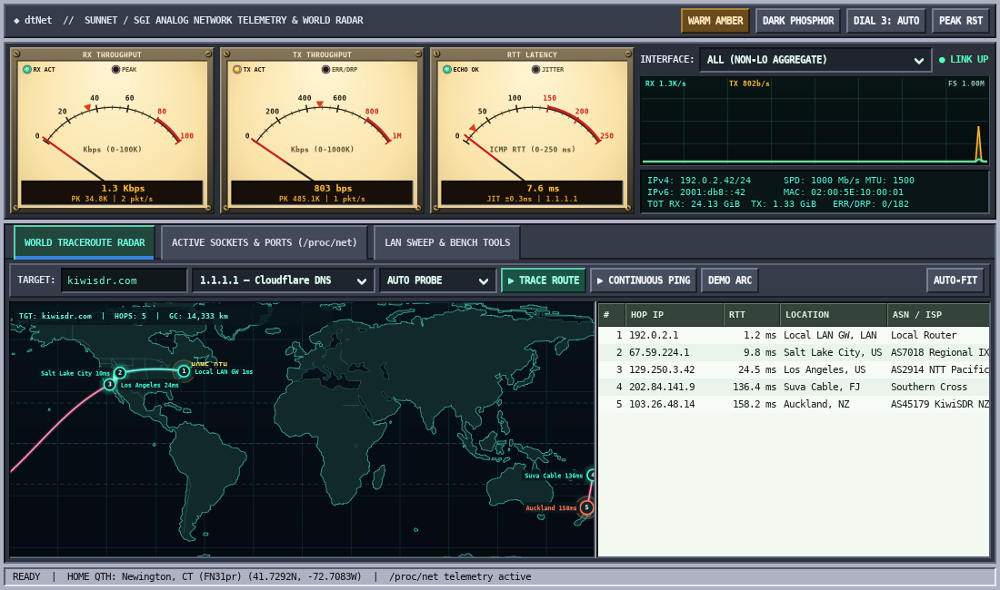
</p>

### Highlights
- **3 Auto-Ranging Analog Network Dials & Phosphor Strip-Chart** — Ballistic gauges for **RX Throughput**, **TX Throughput**, and **Ping RTT / 802.11 Wi-Fi dBm**, paired with a dual-trace rolling throughput chart and live NIC IPv4/IPv6/MAC/MTU/error VFD inspector.
- **Visual World-Map `traceroute` Radar** — Traces any host (`traceroute -n`, `tracepath -n`, or automatic rootless `ping -t <ttl>` fallback), geolocates hops with local caching, and plots glowing neon great-circle hop arcs across an offline vector world map.
- **`/proc/net` Socket Inspector & Diagnostic Bench** — Pure-Python TCP/UDP IPv4/IPv6 socket-to-PID mapper, `/24` LAN & ARP neighbor sweeper, and built-in **DNS / TCP Banner / TLS Certificate / HTTP Header** bench tools.

```bash
cd dtNet && ./install.sh
```
---

##  dtCalc

**Folder:** [`./dtCalc/`](./dtCalc/) &nbsp;•&nbsp; **Front Panel:** `Utilities Subpanel` &nbsp;•&nbsp; **Stack:** C11 • OSF/Motif 2.3 (`libXm`) • Xlib Double-Buffered VFD & 64-Bit LED Matrix

A native C11 and OSF/Motif workstation calculator inspired by classic HP-48 and HP-16C bench units. Features a custom-rendered **Vacuum Fluorescent Display** (`Cyan VFD`, `HP Red LED`, `Amber Plasma`, `Olive LCD`), switchable **4-level RPN stack** and **Algebraic** modes, **RF bench keys (`f↔λ`, `dBm↔W`, `LC MHz`, `dBV`)**, clickable **64-bit binary LED bit switches**, and a `#FFF7E9` Motif paper-tape roll.

<p align="center">
  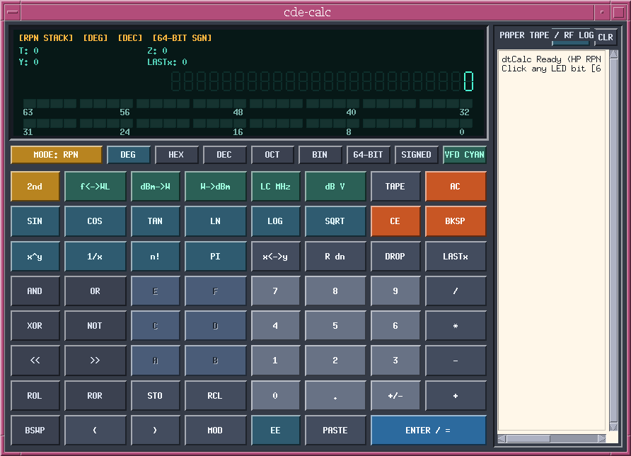
</p>

### Highlights
- **Pure C11 + OSF/Motif 2.3 (`libXm`)** — Instantaneous native X11 startup with genuine 3D beveled `XmPushButton` tactile keycaps, dynamic CDE `xrdb` palette binding, and full keyboard navigation.
- **4-Level RPN Stack + Full Algebraic Expression Evaluator** — Toggle seamlessly between classic HP `T / Z / Y / X` RPN stack operations (`ENTER`, `SWAP`, `DROP`, `ROLL`, `LASTX`) and parenthesized algebraic infix evaluation.
- **RF / Electronics Bench Keys & Clickable 64-Bit Programmer Matrix** — Dedicated **`f↔λ`**, **`dBm↔W`**, **`dBV`**, **`∥R`** (parallel resistors), and **`LC MHz`** resonance keys alongside interactive `64/32/16/8-bit` `HEX / DEC / OCT / BIN` LED toggle switches and a copyable paper-tape roll.

```bash
cd dtCalc && ./install.sh
```
---

##  dtDeluge

**Folder:** [`./dtDeluge/`](./dtDeluge/) &nbsp;•&nbsp; **Front Panel:** `Utilities Subpanel` &nbsp;•&nbsp; **Stack:** Python 3 • GTK 3 (CDE Motif CSS) • Cairo • Pure-Python BitTorrent (`BEP-3/9/10/15`)

A faithful Transmission-style BitTorrent client crafted in CDE OSF/Motif livery. Supports `.torrent` files (open, drag-and-drop, and `.torrent` creator), `magnet:` links (`ut_metadata`), HTTP/HTTPS and UDP trackers, SHA-1 piece verification, Transmission's 3-line transfer cards with beveled Motif progress bars, the 5-tab **Inspector** (`Info`, `Peers`, `Trackers`, `Files`, `Pieces`), and the bottom **Turtle Alt-Speed** limiter.

<p align="center">
  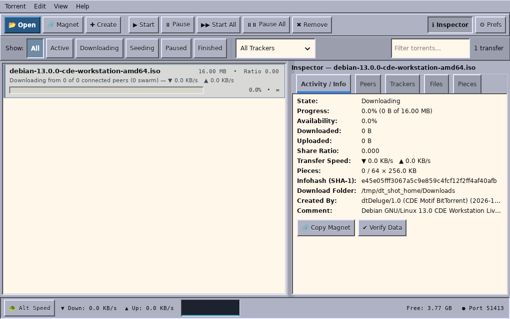
</p>

### Highlights
- **Zero-External-Daemon BitTorrent Engine (`BEP-3 / 9 / 10 / 15`)** — Built-in async peer wire loop supporting `.torrent` files, `magnet:` metadata exchange (`ut_metadata`), HTTP/HTTPS & UDP tracker announces, SHA-1 piece verification, token-bucket speed caps, and resume state persistence.
- **Signature Transmission Workflow in CDE Beveled Chrome** — Compact 3-line transfer rows on `#FFF7E9`/`#EEF4DB` greenbar paper with color-coded Motif 3D progress troughs (Sapphire downloading, Emerald seeding, Amber verifying, Slate paused) and status/search filter pills.
- **5-Tab Inspector Drawer & `.torrent` Creator** — Toggleable right-hand **Inspector** (`Info`, `Peers`, `Trackers`, `Files` with per-file priority/skip, and Cairo **Piece Availability Bitmap**), plus a built-in `.torrent` generator and 1-click **`[🐢 Alt-Speed]`** bandwidth turtle.

```bash
cd dtDeluge && ./install.sh
```


---

## License

Released under the [MIT License](./LICENSE).
