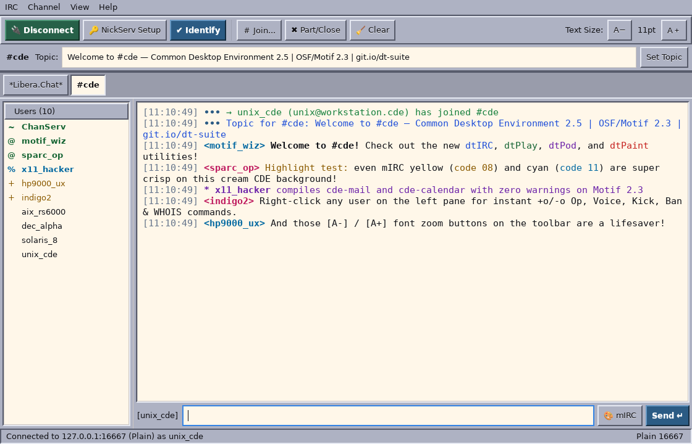

#  dtIRC — Full-Featured Libera.Chat TLS IRC Client with Cream mIRC Palette

> **CDE Front Panel Placement:** `Utilities Subpanel`  
> **Technology Stack:** Python 3 • GTK 3 (CDE Motif CSS) • Python `ssl` Socket Engine • RFC 1459 / IRCv3 SASL

A full-featured CDE IRC client pre-wired to connect to `irc.libera.chat:6697` over TLS. Features saved NickServ credentials (`0600` permissions) with SASL PLAIN and customizable `IDENTIFY` commands, a left-hand ranked channel user list with right-click Operator actions, a directly editable top channel topic bar, cream-adapted mIRC colors, and instant font zoom buttons.



## Key Features

- **Libera.Chat TLS & Saved NickServ Auth** — Supports both IRCv3 `SASL PLAIN` during connection and saved `/msg NickServ IDENTIFY` templates + a 1-click **`✔ Identify`** toolbar button.
- **Left-Hand Ranked User List & Right-Click Op Menu** — Sorts `~`, `&`, `@`, `%`, `+` ranks on the left; right-click any nick for **Op/Deop**, **Voice/Devoice**, **Half-Op**, **Kick**, **Ban (`*!*@host`)**, **Kick + Ban**, **Quiet/Unquiet (`+q`/`-q`)**, **WHOIS**, **PM**, and **CTCP**.
- **Top Editable Channel Topic Bar** — View and update the active channel's `TOPIC` directly from the top entry bar.
- **Cream-Refactored mIRC Colors & `[A−]`/`[A＋]` Zoom** — Full mIRC `00`–`99` color/bold/italic/underline parser tuned for high contrast on CDE's `#FFF7E9` cream background, plus 1-click text scaling (`8pt`–`26pt`) and complete `/command` support.

## Installation

```bash
cd dtIRC && ./install.sh
```

This installs the executable into `~/.local/bin/`, copies the multi-resolution CDE XPM icons (`.pm`, `.l.pm`, `.m.pm`, `.s.pm`, `.t.pm`) into `~/.dt/icons/`, registers the CDE `ACTION` and file data types in `~/.dt/types/`, adds the Front Panel control to `~/.dt/types/fp_dynamic/`, and reloads `dtaction ReloadActions`.

## Running

```bash
~/.local/bin/dtirc
```

---

[← Back to the `dt` CDE Application Suite](../README.md)
