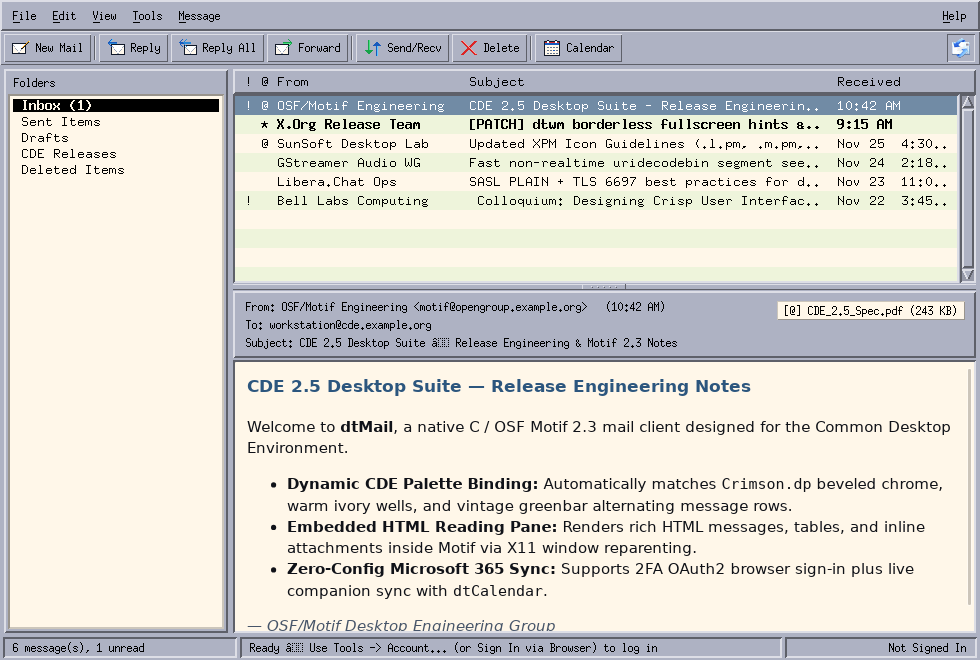

#  dtMail — Native OSF/Motif 2.3 Microsoft 365 & Mail Client

> **CDE Front Panel Placement:** `Mail Subpanel`  
> **Technology Stack:** C11 • OSF/Motif (`libXm` / `libDtWidget`) • Python 3 Graph Sync • WebKit2GTK Reading Pane

A classic three-pane workstation mail client written in C and OSF/Motif 2.3 that binds dynamically to your active CDE color palette. Features zero-config Microsoft 365 browser sign-in (OAuth 2.0 + 2FA), an SQLite3 local message cache, vintage greenbar alternating message rows, an embedded HTML reading pane via X11 window reparenting, attachment chips, and 1-click RSVP integration with `dtCalendar`.



## Key Features

- **Dynamic CDE Palette Binding** — Reads `*ColorPalette` (`Crimson.dp`, `Broica.dp`, etc.) for 3D beveled Motif chrome, warm ivory wells (`#FFF7E9`), and subtle greenbar row shading (`#EEF4DB`), plus an optional Dark Motif toggle.
- **Zero-Config Microsoft 365 OAuth 2.0 + 2FA** — Sign in via WebKit2GTK (`cde-mail-webauth`) and sync folders, subfolders, and messages over Microsoft Graph v1.0.
- **Embedded HTML Reading Pane** — Safely renders HTML emails (JavaScript disabled) inside the bottom-right Motif `XmDrawingArea` with synchronized `Ctrl++` / `Ctrl+-` font scaling.
- **Meeting Invitation Banner** — Detects `.ics` and Exchange calendar invites with inline **Accept / Tentative / Decline** actions synchronized directly with `dtCalendar`.

## Installation

```bash
cd dtMail && make && ./install.sh
```

This installs the executable into `~/.local/bin/`, copies the multi-resolution CDE XPM icons (`.pm`, `.l.pm`, `.m.pm`, `.s.pm`, `.t.pm`) into `~/.dt/icons/`, registers the CDE `ACTION` and file data types in `~/.dt/types/`, adds the Front Panel control to `~/.dt/types/fp_dynamic/`, and reloads `dtaction ReloadActions`.

## Running

```bash
~/.local/bin/dtmail
```

---

[← Back to the `dt` CDE Application Suite](../README.md)
