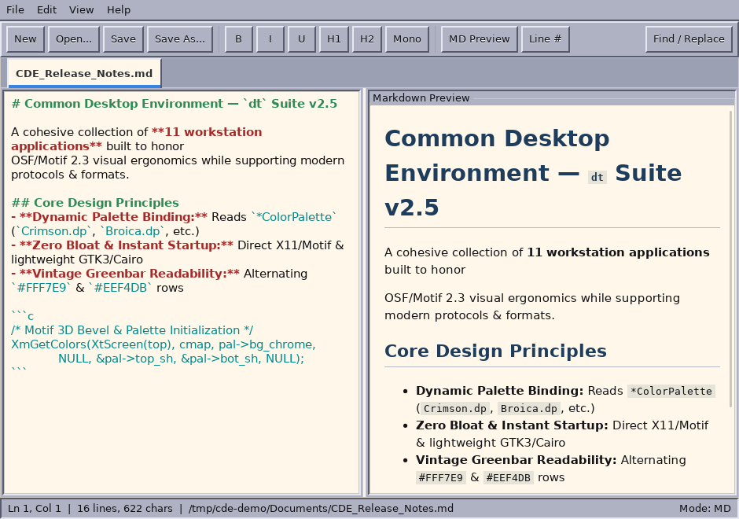

#  dtNotes — Multi-Tab Rich Text (`.rtf`), Markdown (`.md`) & Code Editor

> **CDE Front Panel Placement:** `Utilities Subpanel`  
> **Technology Stack:** Python 3 • GTK 3 • GtkSourceView 4 • WebKit2GTK Live Markdown Preview

A modern replacement for stock `dtpad` styled for CDE. Supports multi-tab editing, native Rich Text Format (`.rtf`) reading and writing with bold/italic/underline/font colors, side-by-side Markdown (`.md`) live preview, and syntax-highlighted plain text and source files.



## Key Features

- **Native `.rtf` Serializer & Parser** — Edit formatted Rich Text documents without heavyweight office suites.
- **Live Markdown Split Preview** — Toggle a live CDE-themed WebKit2 preview pane while writing `.md` documentation.
- **GtkSourceView 4 Engine** — Line numbers, undo/redo, find & replace, and syntax highlighting in warm CDE cream wells.

## Installation

```bash
cd dtNotes && ./install.sh
```

This installs the executable into `~/.local/bin/`, copies the multi-resolution CDE XPM icons (`.pm`, `.l.pm`, `.m.pm`, `.s.pm`, `.t.pm`) into `~/.dt/icons/`, registers the CDE `ACTION` and file data types in `~/.dt/types/`, adds the Front Panel control to `~/.dt/types/fp_dynamic/`, and reloads `dtaction ReloadActions`.

## Running

```bash
~/.local/bin/dtnotes [document]
```

---

[← Back to the `dt` CDE Application Suite](../README.md)
