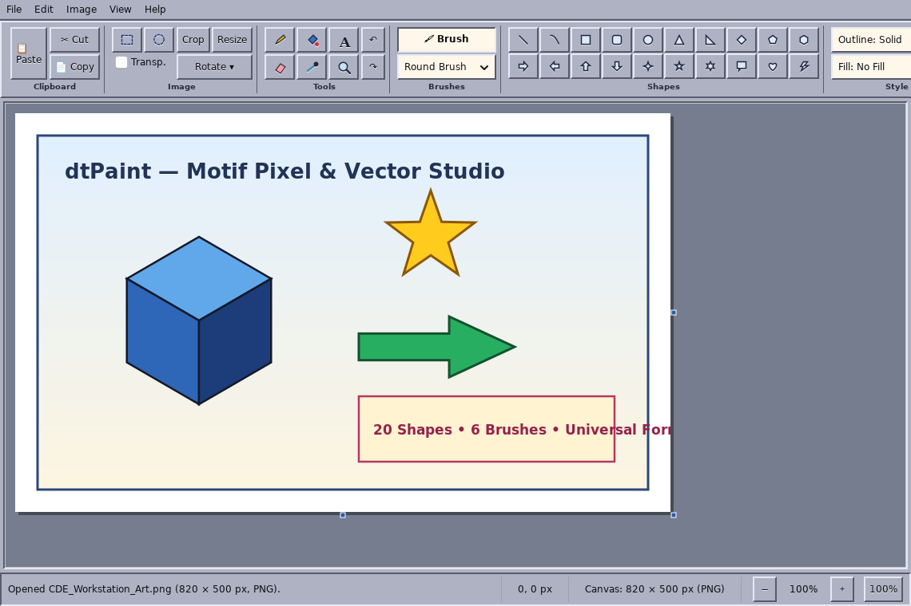

#  dtPaint — Classic MS Paint Ribbon Studio with Universal Image Format Support

> **CDE Front Panel Placement:** `Utilities Subpanel`  
> **Technology Stack:** Python 3 • GTK 3 (CDE Motif CSS) • Cairo • Pillow • GdkPixbuf • ImageMagick

A faithful CDE clone of classic MS Paint upgraded to open and save every modern and vintage image format supported by `dtPics`. Combines the iconic MS Paint Ribbon workflow — selection modes, brushes, 20 geometric shapes, flood fill, Color 1 / Color 2 mouse buttons, and draggable canvas resize handles — with authentic CDE beveled chrome and custom vector tool icons.



## Key Features

- **Universal Image I/O** — Opens and exports `.png`, `.jpg`, `.bmp`, `.gif`, `.heic`, `.avif`, `.jxl`, `.webp`, `.tiff`, `.svg`, `.ico`, `.icns`, `.ppm`, `.xpm`, `.tga`, and `.psd`.
- **Full MS Paint Toolkit** — Rectangular & Free-Form Lasso selection (with **Transparent Selection** background keying), Cut/Copy/Paste floating selections, Pencil, Flood Fill, Text Box, Eraser (Color 2), Eyedropper, and Magnifier.
- **6 Brushes & 20 Geometry Shapes** — Round, Square, Calligraphy `/` & `\`, Airbrush Spray, and Marker brushes; Line, 2-step bendable Bezier Curve, Oval, Rounded Rect, Polygons, 4-way Arrows, 4/5/6-Point Stars, Speech Callout, Heart, and Lightning Bolt.
- **Seamless Workflow** — Integrated directly with `dtPics` and CDE Screenshot via **Open with dtPaint**, plus 30-step Undo/Redo.

## Installation

```bash
cd dtPaint && ./install.sh
```

This installs the executable into `~/.local/bin/`, copies the multi-resolution CDE XPM icons (`.pm`, `.l.pm`, `.m.pm`, `.s.pm`, `.t.pm`) into `~/.dt/icons/`, registers the CDE `ACTION` and file data types in `~/.dt/types/`, adds the Front Panel control to `~/.dt/types/fp_dynamic/`, and reloads `dtaction ReloadActions`.

## Running

```bash
~/.local/bin/dtpaint [image_file]
```

---

[← Back to the `dt` CDE Application Suite](../README.md)
