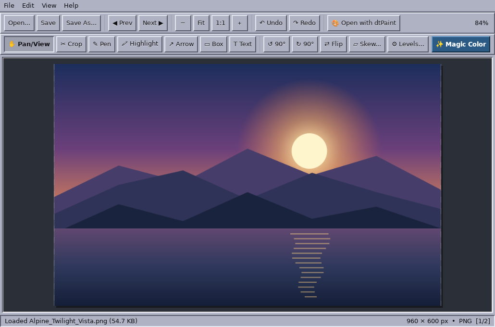

#  dtPics — Universal Image Viewer, 1-Click Magic Color & Photo Markup Studio

> **CDE Front Panel Placement:** `Utilities Subpanel`  
> **Technology Stack:** Python 3 • GTK 3 (CDE Motif CSS) • Cairo • Pillow • GdkPixbuf • ImageMagick

A fast CDE image viewer and quick photo editor supporting modern mobile and web formats (HEIC/HEIF, AVIF, JPEG-XL, WebP, animated GIF, SVG, PSD, TIFF, PNG, JPEG, XPM). Includes rule-of-thirds cropping, rotation/skew straightening, 1-click Magic Color auto-enhancement, callout arrows/boxes/text stamps, and 1-click handoff to `dtPaint`.



## Key Features

- **Broad Format Decoding** — Natively views static and animated `.gif`/`.webp`, iPhone `.heic`, `.avif`, `.jxl`, `.svg`, `.psd`, `.ico`, `.xpm`, and standard raster formats.
- **1-Click Magic Color & Manual Levels** — Outlier-safe percentile white balance, adaptive gamma shadow lift, vibrancy, and unsharp clarity.
- **Quick Callouts & Geometry** — Interactive Crop with rule-of-thirds guides, Skew/Straighten preview dialog, Pen, Highlighter, Arrow, Box, and outlined Text overlays.
- **Direct `Open with dtPaint` Button** — Jump straight from viewing/cropping into full pixel editing in `dtPaint`.

## Installation

```bash
cd dtPics && ./install.sh
```

This installs the executable into `~/.local/bin/`, copies the multi-resolution CDE XPM icons (`.pm`, `.l.pm`, `.m.pm`, `.s.pm`, `.t.pm`) into `~/.dt/icons/`, registers the CDE `ACTION` and file data types in `~/.dt/types/`, adds the Front Panel control to `~/.dt/types/fp_dynamic/`, and reloads `dtaction ReloadActions`.

## Running

```bash
~/.local/bin/dtpics [image_file]
```

---

[← Back to the `dt` CDE Application Suite](../README.md)
