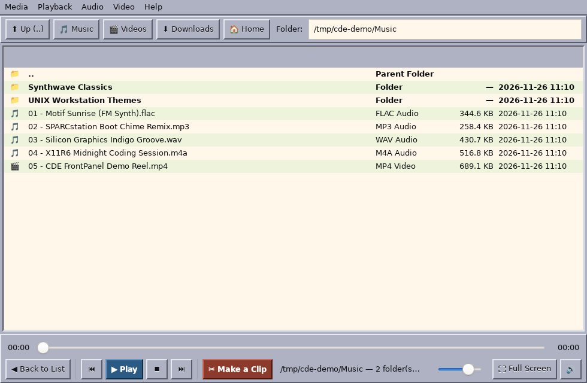

#  dtPlay — VLC-Style Music & Movie Player with 60-Second Clip Studio

> **CDE Front Panel Placement:** `Utilities Subpanel`  
> **Technology Stack:** Python 3 • GTK 3 (CDE Motif CSS) • GStreamer 1.0 (`playbin` + `gtksink` + `x264enc`)

A streamlined CDE music and movie player supporting `.wav`, `.mp3`, `.m4a`, `.m4v`, `.flac`, `.mp4`, `.mov`, `.avi`, `.mpeg`, `.mkv`, `.webm`, `.ogg`, and `.opus`. Opens to `~/Music` in `dtMail`'s signature greenbar directory browser (with `..` parent folder navigation), switches to a native video or retro 20-band spectrum stage on double-click, goes borderless fullscreen, and includes a 1-click **Make a Clip** snippet studio.



## Key Features

- **Greenbar `~/Music` Browser** — Browse `~/Music` or navigate anywhere via `..` and quick folder shortcuts; double-click to play and click **`◀ Back to List`** anytime.
- **Borderless Full Screen (`F11` / `F`)** — Uses `_MOTIF_WM_HINTS` decoration removal + fullscreen state for edge-to-edge cinema playback in `dtwm` with auto-revealing bottom controls.
- **`✂ Make a Clip` (60s Snippet Studio)** — Captures up to 60 seconds of audio or video starting from the moment you press the button and opens it in a second **dtPlay Clip Studio** window to trim `Start`/`End` further or **Save Clip As**.
- **Default CDE Media Handler** — Registers `DtDts` and XDG MIME associations for double-clicked audio and video files.

## Installation

```bash
cd dtPlay && ./install.sh
```

This installs the executable into `~/.local/bin/`, copies the multi-resolution CDE XPM icons (`.pm`, `.l.pm`, `.m.pm`, `.s.pm`, `.t.pm`) into `~/.dt/icons/`, registers the CDE `ACTION` and file data types in `~/.dt/types/`, adds the Front Panel control to `~/.dt/types/fp_dynamic/`, and reloads `dtaction ReloadActions`.

## Running

```bash
~/.local/bin/dtplay [media_file]
```

---

[← Back to the `dt` CDE Application Suite](../README.md)
