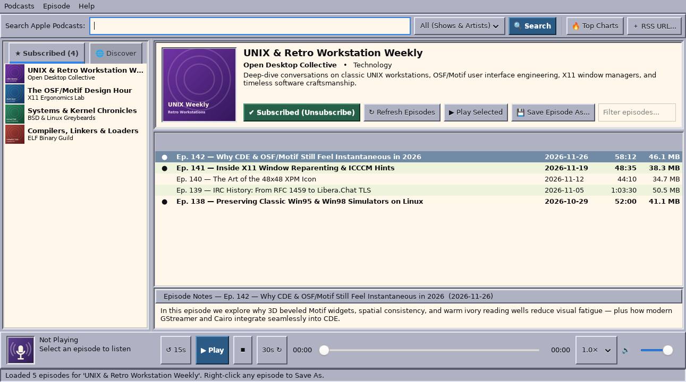

#  dtPod — Apple Podcasts Directory Browser, Subscriber & Streaming Player

> **CDE Front Panel Placement:** `Utilities Subpanel`  
> **Technology Stack:** Python 3 • GTK 3 (CDE Motif CSS) • GStreamer 1.0 • Cairo • Public iTunes API

A full-featured Apple Podcasts browser, subscription manager, and audio player requiring zero login or API keys. Search by show title, artist/creator, or browse the Apple Top 25 chart, subscribe to favorite shows, inspect high-resolution show and episode artwork, read formatted show notes, stream instantly, or right-click any episode to download it for offline listening.



## Key Features

- **Public Apple Podcasts API + RSS Engine** — Search shows, hosts, and artists or load Top Charts with zero account login.
- **Subscriptions & OPML Support** — Subscribe/unsubscribe in one click (`~/.config/dtpod/subscriptions.json`), plus OPML import and export.
- **High-Res Cover Artwork Cache** — Asynchronous disk/memory artwork cache rendering thumbnails in show lists and a `136×136` sunken Motif header frame.
- **Right-Click `Save Episode As...`** — Download episodes in the background with live progress, or stream directly with `-15s`/`+30s` skip and `0.75×`–`2.0×` playback speed.

## Installation

```bash
cd dtPod && ./install.sh
```

This installs the executable into `~/.local/bin/`, copies the multi-resolution CDE XPM icons (`.pm`, `.l.pm`, `.m.pm`, `.s.pm`, `.t.pm`) into `~/.dt/icons/`, registers the CDE `ACTION` and file data types in `~/.dt/types/`, adds the Front Panel control to `~/.dt/types/fp_dynamic/`, and reloads `dtaction ReloadActions`.

## Running

```bash
~/.local/bin/dtpod
```

---

[← Back to the `dt` CDE Application Suite](../README.md)
