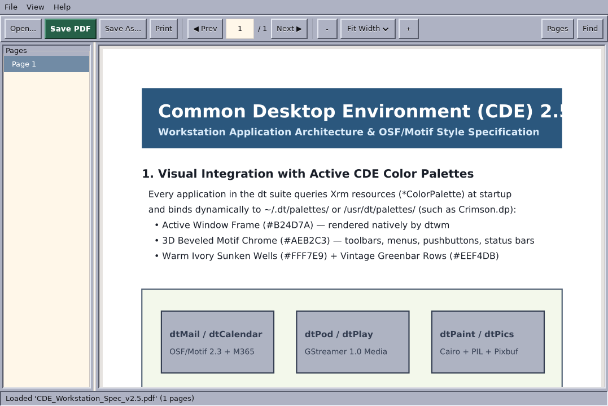

#  dtReader — CDE PDF Document Viewer & Interactive AcroForm Editor

> **CDE Front Panel Placement:** `Utilities Subpanel`  
> **Technology Stack:** Python 3 • GTK 3 • EvinceDocument 3.0 & EvinceView 3.0 (Poppler)

A crisp, fast PDF viewer and fillable form editor for CDE powered by Poppler/Evince. Supports page thumbnails and document outlines, full-text search, rotation, printing, and direct on-page editing and atomic saving of interactive PDF AcroForm fields.



## Key Features

- **Interactive Fillable PDF Forms** — Click directly into PDF text fields, checkboxes, radio buttons, and dropdowns and save cleanly (`Ctrl+S` / `Ctrl+Shift+S`).
- **Sidebar Thumbnails & Outline Index** — Navigate long technical manuals and specifications effortlessly.
- **Native Print & Search** — Integrated GTK/CUPS printing and instant highlight search.

## Installation

```bash
cd dtReader && ./install.sh
```

This installs the executable into `~/.local/bin/`, copies the multi-resolution CDE XPM icons (`.pm`, `.l.pm`, `.m.pm`, `.s.pm`, `.t.pm`) into `~/.dt/icons/`, registers the CDE `ACTION` and file data types in `~/.dt/types/`, adds the Front Panel control to `~/.dt/types/fp_dynamic/`, and reloads `dtaction ReloadActions`.

## Running

```bash
~/.local/bin/dtreader [file.pdf]
```

---

[← Back to the `dt` CDE Application Suite](../README.md)
