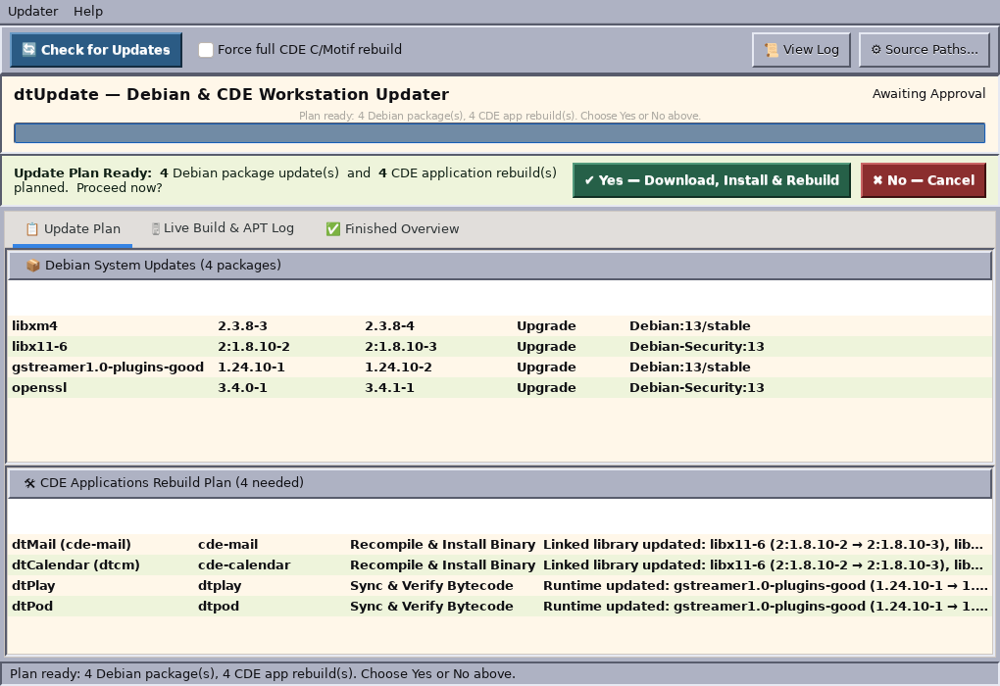

#  dtUpdate — All-in-One Debian & CDE Application Update Manager

> **CDE Front Panel Placement:** `Utilities Subpanel`  
> **Technology Stack:** Python 3 • GTK 3 (CDE Motif CSS) • APT (`Status-Fd`) • ELF `ldd` / `dpkg -S` Dependency Analyzer

An all-in-one workstation update manager for Debian (`apt-get`) and custom Common Desktop Environment (CDE) applications. Prompts securely for `sudo`, refreshes Debian package lists, inspects every installed CDE C/Motif binary and Python utility to plan targeted rebuilds **only when needed**, asks for explicit **Yes / No** approval, downloads and installs updates with a live progress bar, recompiles affected CDE binaries atomically, restarts `dtwm`, and presents a full post-update overview.



## Key Features

- **In-Memory `sudo` Authentication & `apt-get update`** — Prompts for your `sudo` password in a Motif-styled dialog (kept strictly in session memory, never written to disk) and streams `apt-get update` + `apt-get -s dist-upgrade`.
- **Smart CDE Rebuild Planner (Only When Needed)** — Batches `ldd -r` and `dpkg -S` across installed CDE C/Motif binaries (`dtMail`, `dtCalendar`, panel applets, shared objects) plus local source timestamps and Python GI/GStreamer runtime dependencies so unaffected apps are never needlessly rebuilt.
- **Explicit `[✔ Yes]` / `[✖ No]` Plan Confirmation** — Displays itemized greenbar tables of pending Debian upgrades and planned CDE application rebuilds before making any changes.
- **Live Progress Bar, Atomic Rebuilds & `dtwm` Restart** — Tracks APT download and installation percentages via `APT::Status-Fd`, recompiles needed C/Motif targets via atomic `.dtupd_new` replacement, restarts the CDE Workspace Manager (`dtwm`), and opens a **Finished Overview** changelog summary.

## Installation

```bash
cd dtUpdate && ./install.sh
```

This installs the executable into `~/.local/bin/`, copies the multi-resolution CDE XPM icons (`.pm`, `.l.pm`, `.m.pm`, `.s.pm`, `.t.pm`) into `~/.dt/icons/`, registers the CDE `ACTION` in `~/.dt/types/`, adds the Front Panel control to `~/.dt/types/fp_dynamic/`, and reloads `dtaction ReloadActions`.

## Running

```bash
~/.local/bin/dtupdate
```

---

[← Back to the `dt` CDE Application Suite](../README.md)
