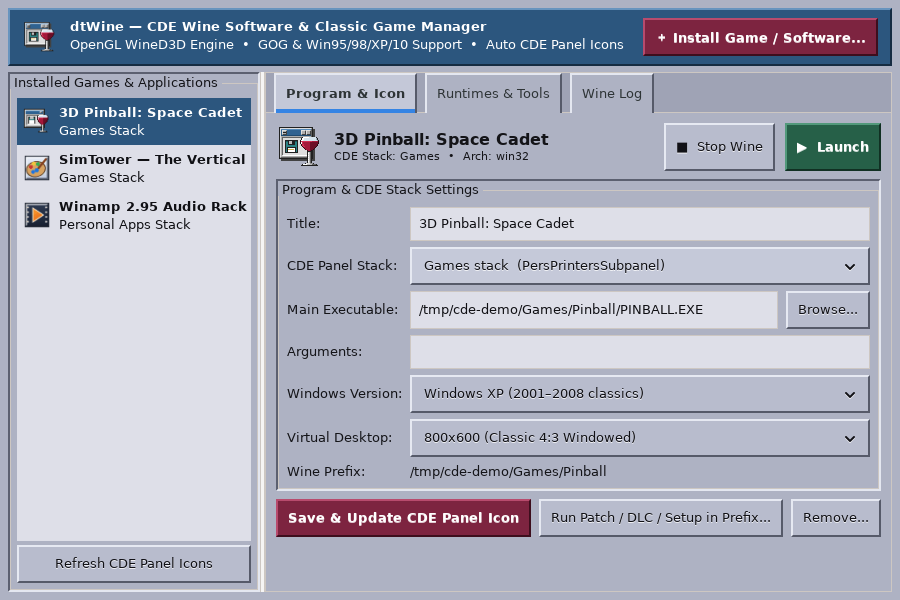

#  dtWine — Classic Windows Game & Application Prefix Manager for CDE

> **CDE Front Panel Placement:** `Utilities Subpanel`  
> **Technology Stack:** Python 3 • GTK 3 (CDE Motif CSS) • Wine • Pure-Python PE/NE/ICO Icon Extractor

Manages classic Windows 95/98/XP/7/10 applications and offline GOG installers on CDE. Automatically configures compatible OpenGL WineD3D prefixes, extracts 32-bit PE and vintage 16-bit NE executable icons into multi-size CDE `.pm` XPM icons, and registers launchers directly into CDE's **Games** or **Personal Applications** Front Panel subpanels.



## Key Features

- **GOG & Classic Installer Wizard** — Installs `.exe`, `.msi`, `.bat`, or portable folders into clean Wine prefixes while filtering out `Uninstall`/`Setup`/`Readme` clutter.
- **Pure-Python PE32 / PE32+ / 16-Bit NE Icon Extractor** — Converts embedded Windows DIB icons + 1-bit AND masks into native CDE `.l.pm`/`.m.pm`/`.s.pm`/`.t.pm` icons.
- **Per-App Windows Version & Virtual Desktop** — Switch `win95`..`win10`, `640x480`..`1280x720` virtual desktops, Winetricks runtimes, `winecfg`, and `regedit` in one click.

## Installation

```bash
cd dtWine && ./install.sh
```

This installs the executable into `~/.local/bin/`, copies the multi-resolution CDE XPM icons (`.pm`, `.l.pm`, `.m.pm`, `.s.pm`, `.t.pm`) into `~/.dt/icons/`, registers the CDE `ACTION` and file data types in `~/.dt/types/`, adds the Front Panel control to `~/.dt/types/fp_dynamic/`, and reloads `dtaction ReloadActions`.

## Running

```bash
~/.local/bin/dtwine
```

---

[← Back to the `dt` CDE Application Suite](../README.md)
