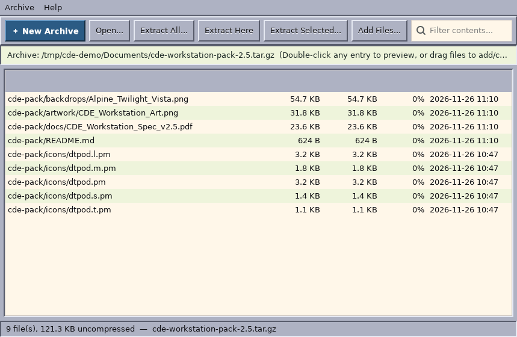

#  dtZip — Drag-and-Drop Archive Manager for CDE

> **CDE Front Panel Placement:** `Utilities Subpanel`  
> **Technology Stack:** Python 3 • GTK 3 (CDE Motif CSS) • `zipfile` / `tarfile` / `7z`

A classic UNIX/CDE archive utility supporting drag-and-drop extraction and creation of `.zip`, `.tar.gz`/`.tgz`, `.tar.bz2`, `.tar.xz`, `.tar.zst`, `.tar`, `.7z`, `.rar`, `.iso`, `.gz`, `.bz2`, and `.xz` archives, including `Extract Here` integration in `dtfile`.



## Key Features

- **Universal Archive Inspection & Extraction** — Browse contents, sizes, ratios, and timestamps before extracting.
- **Drag-and-Drop Archive Creation** — Drop files or folders onto `dtZip` to package `.zip`, `.tar.gz`, `.tar.xz`, or `.7z` archives.
- **CDE File Manager Integration** — Adds `Open` and `Extract Here (dtZip)` actions to archive data types.

## Installation

```bash
cd dtZip && ./install.sh
```

This installs the executable into `~/.local/bin/`, copies the multi-resolution CDE XPM icons (`.pm`, `.l.pm`, `.m.pm`, `.s.pm`, `.t.pm`) into `~/.dt/icons/`, registers the CDE `ACTION` and file data types in `~/.dt/types/`, adds the Front Panel control to `~/.dt/types/fp_dynamic/`, and reloads `dtaction ReloadActions`.

## Running

```bash
~/.local/bin/dtzip [archive]
```

---

[← Back to the `dt` CDE Application Suite](../README.md)
